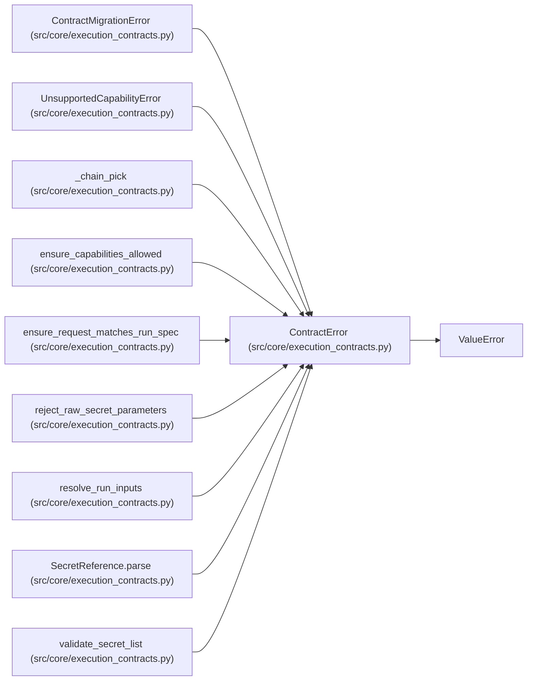

# ContractError

**Location:** `src/core/execution_contracts.py:103`
**Kind:** Class
**Bases:** `ValueError`
**Module:** [execution_contracts](../modules/execution_contracts.md)

## Description

Base error for contract validation and resolution failures.

## Attributes

*No annotated attributes found.*

## Methods

*No public methods. Inherits from base classes.*

## Relationships

<!-- Auto-generated relationship summary. Do not edit by hand. -->

### Summary

| Module | Methods | Attributes |
|---|---:|---|
| [execution_contracts](../modules/execution_contracts.md) | 0 | — |

### Structure

| Kind | Entity | Module |
|---|---|---|
| Base | `ValueError` | — |
| Subclass | `ContractMigrationError` | [execution_contracts](../modules/execution_contracts.md) |
| Subclass | `UnsupportedCapabilityError` | [execution_contracts](../modules/execution_contracts.md) |

### References

| Reference | Kind | Source | Call sites |
|---|---|---|---:|
| `_chain_pick` | call | [execution_contracts](../modules/execution_contracts.md) | 1 |
| `ensure_capabilities_allowed` | call | [execution_contracts](../modules/execution_contracts.md) | 1 |
| `ensure_request_matches_run_spec` | call | [execution_contracts](../modules/execution_contracts.md) | 1 |
| `reject_raw_secret_parameters` | call | [execution_contracts](../modules/execution_contracts.md) | 1 |
| `resolve_run_inputs` | call | [execution_contracts](../modules/execution_contracts.md) | 1 |
| `SecretReference.parse` | call | [execution_contracts](../modules/execution_contracts.md) | 1 |
| `validate_secret_list` | call | [execution_contracts](../modules/execution_contracts.md) | 2 |
