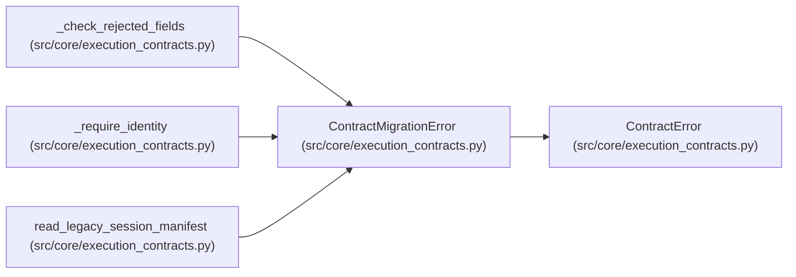

# ContractMigrationError

**Location:** `src/core/execution_contracts.py:113`
**Kind:** Class
**Bases:** `ContractError`
**Module:** [execution_contracts](../modules/execution_contracts.md)

## Description

Raised when a legacy payload requests a rejected incomplete feature.

Carries one entry per offending legacy field so a migration failure names
every problem at once instead of the first one only.

## Attributes

*No annotated attributes found.*

## Methods

| Method | Signature | Decorators | Description |
|--------|-----------|------------|-------------|
| `__init__` | `(message: str, *, issues: Optional[list[Mapping[str, str]]] = None) -> None` | — | — |

## Relationships

<!-- Auto-generated relationship summary. Do not edit by hand. -->

### Summary

| Module | Methods | Attributes |
|---|---:|---|
| [execution_contracts](../modules/execution_contracts.md) | 1 | — |

### Structure

| Kind | Entity | Module |
|---|---|---|
| Base | `ContractError` | [execution_contracts](../modules/execution_contracts.md) |

### References

| Reference | Kind | Source | Call sites |
|---|---|---|---:|
| `_check_rejected_fields` | call | [execution_contracts](../modules/execution_contracts.md) | 1 |
| `_require_identity` | call | [execution_contracts](../modules/execution_contracts.md) | 3 |
| `read_legacy_session_manifest` | call | [execution_contracts](../modules/execution_contracts.md) | 3 |
