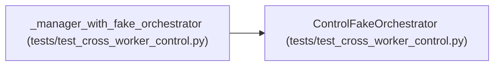

# ControlFakeOrchestrator

**Location:** `tests/test_cross_worker_control.py:55`
**Kind:** Class
**Bases:** —
**Module:** [test_cross_worker_control](../modules/test_cross_worker_control.md)

## Description

Records control requests; never actually runs anything.

## Attributes

*No annotated attributes found.*

## Methods

| Method | Signature | Decorators | Description |
|--------|-----------|------------|-------------|
| `__init__` | `() -> None` | — | — |
| `request_stop` | `(research_id: str) -> None` | — | — |
| `request_pause` | `(research_id: str) -> None` | — | — |
| `request_resume` | `(research_id: str) -> None` | — | — |
| `run` | *(async)* `(config: Any) -> None` | — | — |

## Relationships

<!-- Auto-generated relationship summary. Do not edit by hand. -->

### Summary

| Module | Methods | Attributes |
|---|---:|---|
| [test_cross_worker_control](../modules/test_cross_worker_control.md) | 5 | — |

### References

| Reference | Kind | Source | Call sites |
|---|---|---|---:|
| `_manager_with_fake_orchestrator` | call | [test_cross_worker_control](../modules/test_cross_worker_control.md) | 1 |
| `_manager_with_fake_orchestrator` | type_reference | [test_cross_worker_control](../modules/test_cross_worker_control.md) | — |
