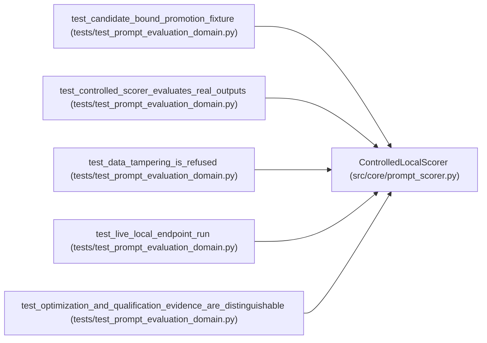

# ControlledLocalScorer

**Location:** `src/core/prompt_scorer.py:178`
**Kind:** Class
**Bases:** —
**Module:** [prompt_scorer](../modules/prompt_scorer.md)

## Description

The declared real scorer: outputs scored against pinned examples.

This is the controlled scoring endpoint's logic. It evaluates real
model outputs; it never invents scores and never falls back to a
simulator — an unreachable endpoint is ``ScorerUnavailable``.

## Attributes

*No annotated attributes found.*

## Methods

| Method | Signature | Decorators | Description |
|--------|-----------|------------|-------------|
| `__init__` | `(*, name: str = 'controlled-local-scorer', version: str = '1.0.0', endpoint: str = 'local://controlled-scorer') -> None` | — | — |
| `identity` | `() -> ScorerIdentity` | — | — |
| `register_dataset` | `(dataset: PinnedDataset) -> None` | — | — |
| `score` | `(request: Mapping[str, Any]) -> dict[str, Any]` | — | — |

## Relationships

<!-- Auto-generated relationship summary. Do not edit by hand. -->

### Summary

| Module | Methods | Attributes |
|---|---:|---|
| [prompt_scorer](../modules/prompt_scorer.md) | 4 | — |

### References

| Reference | Kind | Source | Call sites |
|---|---|---|---:|
| `test_candidate_bound_promotion_fixture` | call | [test_prompt_evaluation_domain](../modules/test_prompt_evaluation_domain.md) | 1 |
| `test_controlled_scorer_evaluates_real_outputs` | call | [test_prompt_evaluation_domain](../modules/test_prompt_evaluation_domain.md) | 1 |
| `test_data_tampering_is_refused` | call | [test_prompt_evaluation_domain](../modules/test_prompt_evaluation_domain.md) | 1 |
| `test_live_local_endpoint_run` | call | [test_prompt_evaluation_domain](../modules/test_prompt_evaluation_domain.md) | 1 |
| `test_optimization_and_qualification_evidence_are_distinguishable` | call | [test_prompt_evaluation_domain](../modules/test_prompt_evaluation_domain.md) | 1 |
