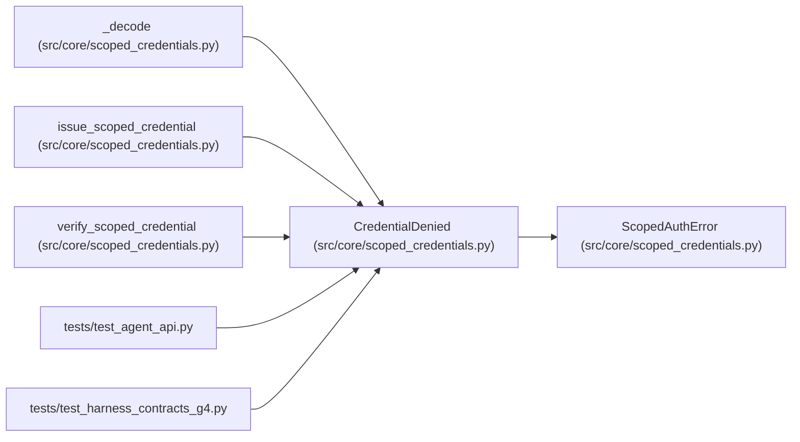

# CredentialDenied

**Location:** `src/core/scoped_credentials.py:46`
**Kind:** Class
**Bases:** `ScopedAuthError`
**Module:** [scoped_credentials](../modules/scoped_credentials.md)

## Description

The credential's scope or permissions do not allow this operation.

## Attributes

*No annotated attributes found.*

## Methods

*No public methods. Inherits from base classes.*

## Relationships

<!-- Auto-generated relationship summary. Do not edit by hand. -->

### Summary

| Module | Methods | Attributes |
|---|---:|---|
| [scoped_credentials](../modules/scoped_credentials.md) | 0 | — |

### Structure

| Kind | Entity | Module |
|---|---|---|
| Base | `ScopedAuthError` | [scoped_credentials](../modules/scoped_credentials.md) |

### References

| Reference | Kind | Source | Call sites |
|---|---|---|---:|
| `_decode` | call | [scoped_credentials](../modules/scoped_credentials.md) | 4 |
| `issue_scoped_credential` | call | [scoped_credentials](../modules/scoped_credentials.md) | 2 |
| `verify_scoped_credential` | call | [scoped_credentials](../modules/scoped_credentials.md) | 3 |
| `test_agent_api` | import | [test_agent_api](../modules/test_agent_api.md) | — |
| `test_harness_contracts_g4` | import | [test_harness_contracts_g4](../modules/test_harness_contracts_g4.md) | — |
