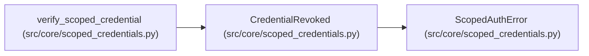

# CredentialRevoked

**Location:** `src/core/scoped_credentials.py:42`
**Kind:** Class
**Bases:** `ScopedAuthError`
**Module:** [scoped_credentials](../modules/scoped_credentials.md)

## Description

The credential was explicitly revoked.

## Attributes

*No annotated attributes found.*

## Methods

*No public methods. Inherits from base classes.*

## Relationships

<!-- Auto-generated relationship summary. Do not edit by hand. -->

### Summary

| Module | Methods | Attributes |
|---|---:|---|
| [scoped_credentials](../modules/scoped_credentials.md) | 0 | — |

### Structure

| Kind | Entity | Module |
|---|---|---|
| Base | `ScopedAuthError` | [scoped_credentials](../modules/scoped_credentials.md) |

### References

| Reference | Kind | Source | Call sites |
|---|---|---|---:|
| `verify_scoped_credential` | call | [scoped_credentials](../modules/scoped_credentials.md) | 1 |
