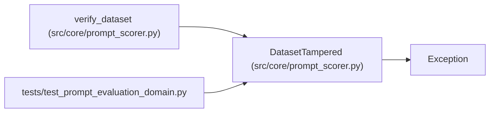

# DatasetTampered

**Location:** `src/core/prompt_scorer.py:34`
**Kind:** Class
**Bases:** `Exception`
**Module:** [prompt_scorer](../modules/prompt_scorer.md)

## Description

A pinned dataset no longer matches its digest.

## Attributes

*No annotated attributes found.*

## Methods

*No public methods. Inherits from base classes.*

## Relationships

<!-- Auto-generated relationship summary. Do not edit by hand. -->

### Summary

| Module | Methods | Attributes |
|---|---:|---|
| [prompt_scorer](../modules/prompt_scorer.md) | 0 | — |

### Structure

| Kind | Entity | Module |
|---|---|---|
| Base | `Exception` | — |

### References

| Reference | Kind | Source | Call sites |
|---|---|---|---:|
| `verify_dataset` | call | [prompt_scorer](../modules/prompt_scorer.md) | 1 |
| `test_prompt_evaluation_domain` | import | [test_prompt_evaluation_domain](../modules/test_prompt_evaluation_domain.md) | — |
