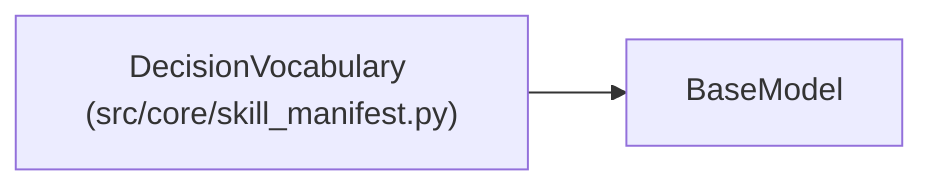

# DecisionVocabulary

**Location:** `src/core/skill_manifest.py:314`
**Kind:** Pydantic model
**Bases:** `BaseModel`
**Module:** [skill_manifest](../modules/skill_manifest.md)

## Description

Closed decision set + success marker (ARC-011 §9, G8).

## Model Configuration

| Setting | Value | Source |
|---------|-------|--------|
| `extra` | `'forbid'` | model_config |

## Attributes

| Name | Type | Wire name | Required | Nullable | Default | Constraints | Examples | Description |
|------|------|-----------|----------|----------|---------|-------------|-------------|----------|
| `base` | `list[str]` | `base` | Yes | No | — | — | — | — |
| `extensions` | `list[str]` | `extensions` | No | No | factory: `list` | — | — | — |
| `success_values` | `list[str]` | `success_values` | No | No | factory: `lambda: ['keep', 'improve']` | — | — | — |

## Methods

*No public methods. Inherits from base classes.*

## Relationships

<!-- Auto-generated relationship summary. Do not edit by hand. -->

### Summary

| Module | Methods | Attributes |
|---|---:|---|
| [skill_manifest](../modules/skill_manifest.md) | 0 | `base`, `extensions`, `success_values` |

### Structure

| Kind | Entity | Module |
|---|---|---|
| Base | `BaseModel` | — |
