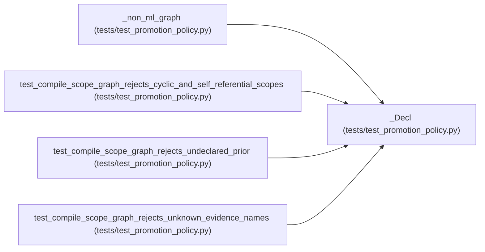

# _Decl

**Location:** `tests/test_promotion_policy.py:33`
**Kind:** Class
**Bases:** —
**Module:** [test_promotion_policy](../modules/test_promotion_policy.md)

## Description

_Auto-generated from `_Decl` in `tests/test_promotion_policy.py`._

## Attributes

*No annotated attributes found.*

## Methods

| Method | Signature | Decorators | Description |
|--------|-----------|------------|-------------|
| `__init__` | `(id, approval_required = False, prior_scopes = None, evidence = None)` | — | — |

## Relationships

<!-- Auto-generated relationship summary. Do not edit by hand. -->

### Summary

| Module | Methods | Attributes |
|---|---:|---|
| [test_promotion_policy](../modules/test_promotion_policy.md) | 1 | — |

### References

| Reference | Kind | Source | Call sites |
|---|---|---|---:|
| `_non_ml_graph` | call | [test_promotion_policy](../modules/test_promotion_policy.md) | 2 |
| `test_compile_scope_graph_rejects_cyclic_and_self_referential_scopes` | call | [test_promotion_policy](../modules/test_promotion_policy.md) | 3 |
| `test_compile_scope_graph_rejects_undeclared_prior` | call | [test_promotion_policy](../modules/test_promotion_policy.md) | 1 |
| `test_compile_scope_graph_rejects_unknown_evidence_names` | call | [test_promotion_policy](../modules/test_promotion_policy.md) | 2 |
