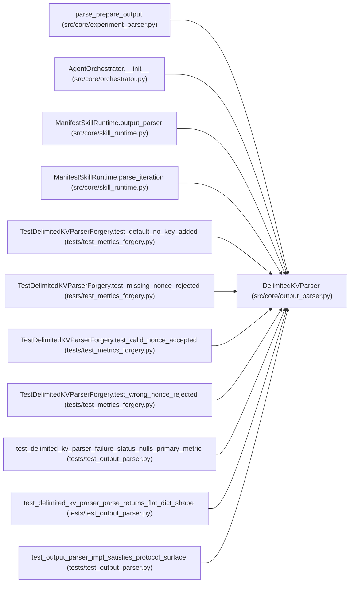

# DelimitedKVParser

**Location:** `src/core/output_parser.py:148`
**Kind:** Class
**Bases:** —
**Module:** [output_parser](../modules/output_parser.md)

## Description

Parse the ``---`` delimited key:value block from ``prepare.py`` stdout.

Extracted verbatim (P1-011) from ``experiment_parser.parse_prepare_output``;
the module-level function is now a thin facade over this class. The body is
unchanged — every load-bearing edge case (``_json`` dual-write, int-via-JSON
preservation, bool coercion for ``auto_phase_evidence`` /
``is_tsfm_candidate`` / ``tsfm_candidate``, ``gate_failures`` semicolon
split, ``ARTIFACT_REFERENCE_KEYS`` normalization, gate-alias reconciliation
with conflict warning, ``FAILURE_STATUSES`` primary_metric nulling) is
preserved bit-for-bit. The X-002 parity fixtures gate this.

Returns a flat dict shaped like ``IterationMetrics.to_dict()`` (the same
shape the orchestrator consumes after calling ``.to_dict()`` on the old
return value). Keys absent from the block take their ``IterationMetrics``
defaults.

## Attributes

*No annotated attributes found.*

## Methods

| Method | Signature | Decorators | Description |
|--------|-----------|------------|-------------|
| `parse` | `(raw_output: str) -> Optional[IterationResult]` | — | Parse the ``---`` delimited block into a flat result dict. |
| `parse_iteration` | `(text: str, *, session_nonce: Optional[bytes] = None, config_snapshot: Optional[str] = None, nonce_field: Optional[str] = None, require_signed_metrics: bool = False) -> Optional[IterationResult]` | — | ``DelimitedKVParser`` does not scan for ``ITERATION_RESULT:`` markers. |

## Relationships

<!-- Auto-generated relationship summary. Do not edit by hand. -->

### Summary

| Module | Methods | Attributes |
|---|---:|---|
| [output_parser](../modules/output_parser.md) | 2 | — |

### References

| Reference | Kind | Source | Call sites |
|---|---|---|---:|
| `parse_prepare_output` | call | [experiment_parser](../modules/experiment_parser.md) | 1 |
| `AgentOrchestrator.__init__` | call | [orchestrator](../modules/orchestrator.md) | 1 |
| `ManifestSkillRuntime.output_parser` | call | [skill_runtime](../modules/skill_runtime.md) | 1 |
| `ManifestSkillRuntime.parse_iteration` | call | [skill_runtime](../modules/skill_runtime.md) | 1 |
| `TestDelimitedKVParserForgery.test_default_no_key_added` | call | [test_metrics_forgery](../modules/test_metrics_forgery.md) | 1 |
| `TestDelimitedKVParserForgery.test_missing_nonce_rejected` | call | [test_metrics_forgery](../modules/test_metrics_forgery.md) | 1 |
| `TestDelimitedKVParserForgery.test_valid_nonce_accepted` | call | [test_metrics_forgery](../modules/test_metrics_forgery.md) | 1 |
| `TestDelimitedKVParserForgery.test_wrong_nonce_rejected` | call | [test_metrics_forgery](../modules/test_metrics_forgery.md) | 1 |
| `test_delimited_kv_parser_failure_status_nulls_primary_metric` | call | [test_output_parser](../modules/test_output_parser.md) | 1 |
| `test_delimited_kv_parser_parse_returns_flat_dict_shape` | call | [test_output_parser](../modules/test_output_parser.md) | 1 |
| `test_output_parser_impl_satisfies_protocol_surface` | type_reference | [test_output_parser](../modules/test_output_parser.md) | — |
