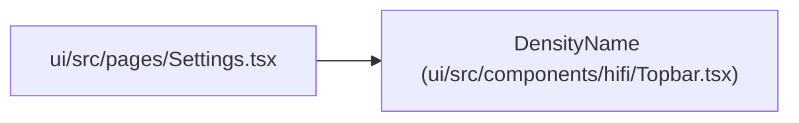

# DensityName

**Location:** `ui/src/components/hifi/Topbar.tsx:9`
**Kind:** Type alias
**Bases:** —
**Module:** [Topbar](../modules/Topbar.md)

## Description

_Auto-generated from `DensityName` in `ui/src/components/hifi/Topbar.tsx`._

## Attributes

*No annotated attributes found.*

## Methods

*No public methods. Inherits from base classes.*

## Relationships

<!-- Auto-generated relationship summary. Do not edit by hand. -->

### Summary

| Module | Methods | Attributes |
|---|---:|---|
| [Topbar](../modules/Topbar.md) | 0 | — |

### References

| Reference | Kind | Source | Call sites |
|---|---|---|---:|
| `Settings` | import | [Settings](../modules/Settings.md) | — |
