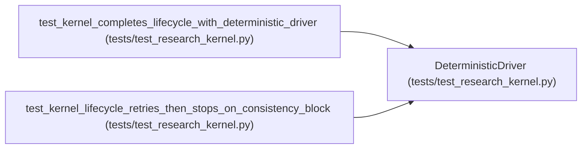

# DeterministicDriver

**Location:** `tests/test_research_kernel.py:232`
**Kind:** Class
**Bases:** —
**Module:** [test_research_kernel](../modules/test_research_kernel.md)

## Description

_Auto-generated from `DeterministicDriver` in `tests/test_research_kernel.py`._

## Attributes

*No annotated attributes found.*

## Methods

| Method | Signature | Decorators | Description |
|--------|-----------|------------|-------------|
| `__init__` | `(outcomes)` | — | — |
| `run_attempt` | `(plan, *, attempt_index, context)` | — | — |

## Relationships

<!-- Auto-generated relationship summary. Do not edit by hand. -->

### Summary

| Module | Methods | Attributes |
|---|---:|---|
| [test_research_kernel](../modules/test_research_kernel.md) | 2 | — |

### References

| Reference | Kind | Source | Call sites |
|---|---|---|---:|
| `test_kernel_completes_lifecycle_with_deterministic_driver` | call | [test_research_kernel](../modules/test_research_kernel.md) | 1 |
| `test_kernel_lifecycle_retries_then_stops_on_consistency_block` | call | [test_research_kernel](../modules/test_research_kernel.md) | 1 |
