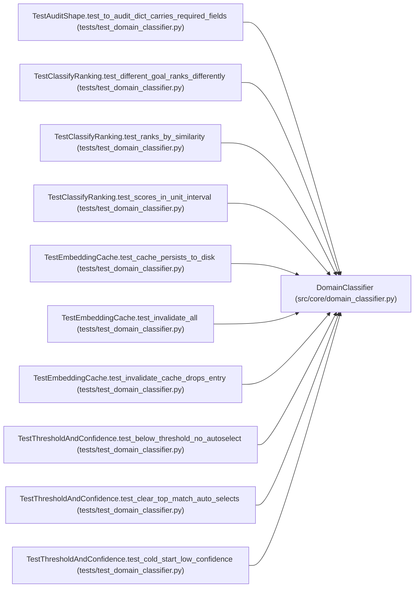

# DomainClassifier

**Location:** `src/core/domain_classifier.py:227`
**Kind:** Class
**Bases:** —
**Module:** [domain_classifier](../modules/domain_classifier.md)

## Description

Rank installed skills by similarity to a natural-language ``goal``.

Parameters
----------
registry:
    The ``SkillRegistry`` to read installed-skill metadata from.
backend:
    Embedding backend (default ``LexicalEmbeddingBackend`` built from the
    installed skills' descriptions as the IDF background corpus).
threshold:
    Auto-select threshold (P5-019). Top match ≥ threshold and clear of the
    runner-up ⇒ ``auto_selected``; else the caller surfaces the list.
cache_path:
    Optional JSON file for the embedding cache (survives restarts).

## Attributes

*No annotated attributes found.*

## Methods

| Method | Signature | Decorators | Description |
|--------|-----------|------------|-------------|
| `__init__` | `(*, registry: SkillRegistry, backend: Optional[EmbeddingBackend] = None, threshold: float = DEFAULT_AUTO_SELECT_THRESHOLD, cache_path: Optional[Path] = None) -> None` | — | — |
| `_background_corpus` | `() -> list[str]` | — | Build the IDF background corpus from installed skills' text. |
| `classify` | `(goal: str) -> ClassificationResult` | — | Rank installed skills by similarity to ``goal`` (P5-016). |
| `_cached_embed` | `(skill_id: str, manifest: ResearchSkillManifest) -> Sequence[float]` | — | — |
| `invalidate_cache` | `(skill_id: Optional[str] = None) -> None` | — | Drop the cached embedding for one skill (or all). Call on |
| `_apply_threshold` | `(matches: list[SkillMatch]) -> tuple[Optional[str], list[SkillMatch]]` | — | — |

## Relationships

<!-- Auto-generated relationship summary. Do not edit by hand. -->

### Summary

| Module | Methods | Attributes |
|---|---:|---|
| [domain_classifier](../modules/domain_classifier.md) | 6 | — |

### References

| Reference | Kind | Source | Call sites |
|---|---|---|---:|
| `TestAuditShape.test_to_audit_dict_carries_required_fields` | call | [test_domain_classifier](../modules/test_domain_classifier.md) | 1 |
| `TestClassifyRanking.test_different_goal_ranks_differently` | call | [test_domain_classifier](../modules/test_domain_classifier.md) | 1 |
| `TestClassifyRanking.test_ranks_by_similarity` | call | [test_domain_classifier](../modules/test_domain_classifier.md) | 1 |
| `TestClassifyRanking.test_scores_in_unit_interval` | call | [test_domain_classifier](../modules/test_domain_classifier.md) | 1 |
| `TestEmbeddingCache.test_cache_persists_to_disk` | call | [test_domain_classifier](../modules/test_domain_classifier.md) | 1 |
| `TestEmbeddingCache.test_invalidate_all` | call | [test_domain_classifier](../modules/test_domain_classifier.md) | 1 |
| `TestEmbeddingCache.test_invalidate_cache_drops_entry` | call | [test_domain_classifier](../modules/test_domain_classifier.md) | 1 |
| `TestThresholdAndConfidence.test_below_threshold_no_autoselect` | call | [test_domain_classifier](../modules/test_domain_classifier.md) | 1 |
| `TestThresholdAndConfidence.test_clear_top_match_auto_selects` | call | [test_domain_classifier](../modules/test_domain_classifier.md) | 1 |
| `TestThresholdAndConfidence.test_cold_start_low_confidence` | call | [test_domain_classifier](../modules/test_domain_classifier.md) | 1 |
