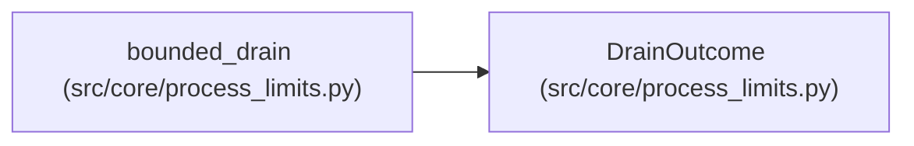

# DrainOutcome

**Location:** `src/core/process_limits.py:247`
**Kind:** Class
**Bases:** —
**Module:** [process_limits](../modules/process_limits.md)

**Decorators:** `@dataclass(frozen=True)`

## Description

Result of one bounded drain: captured bytes plus attributed status.

## Attributes

| Name | Type | Default | Description |
|------|------|---------|-------------|
| `stdout` | `bytes` | *required* | — |
| `stderr` | `bytes` | *required* | — |
| `timed_out` | `bool` | `False` | — |
| `violation` | `Optional[str]` | `None` | — |
| `cleanup_incomplete` | `bool` | `False` | — |

## Methods

*No public methods. Inherits from base classes.*

## Relationships

<!-- Auto-generated relationship summary. Do not edit by hand. -->

### Summary

| Module | Methods | Attributes |
|---|---:|---|
| [process_limits](../modules/process_limits.md) | 0 | `cleanup_incomplete`, `stderr`, `stdout`, `timed_out`, `violation` |

### References

| Reference | Kind | Source | Call sites |
|---|---|---|---:|
| `bounded_drain` | call | [process_limits](../modules/process_limits.md) | 1 |
| `bounded_drain` | type_reference | [process_limits](../modules/process_limits.md) | — |
