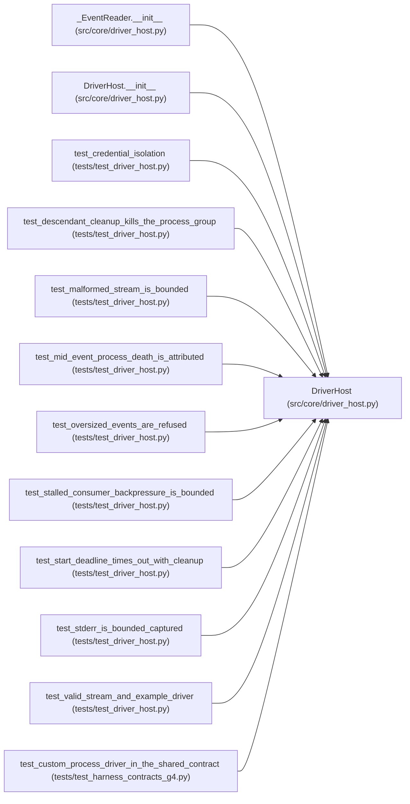

# DriverHost

**Location:** `src/core/driver_host.py:147`
**Kind:** Class
**Bases:** —
**Module:** [driver_host](../modules/driver_host.md)

## Description

Supervises one custom driver process through the JSONL transport.

## Attributes

*No annotated attributes found.*

## Methods

| Method | Signature | Decorators | Description |
|--------|-----------|------------|-------------|
| `__init__` | `(config: DriverHostConfig) -> None` | — | — |
| `start` | `() -> None` | — | Launch the driver in its isolated context. |
| `_drain_stderr` | `() -> None` | — | Bounded stderr capture: never unbounded, never lost silently. |
| `_record` | `(event: dict[str, Any]) -> None` | — | — |
| `events` | `(*, wait_s: float = 0.0) -> list[dict[str, Any]]` | — | Drain the normalized events delivered so far. |
| `wait` | `(*, timeout_s: float) -> DriverOutcome` | — | Wait for the driver to finish; enforce the start deadline. |
| `cancel` | `(*, reason: str = '') -> None` | — | Terminate the driver's whole process group, bounded in time. |
| `_finish` | `(status: str, reason: str) -> DriverOutcome` | — | — |
| `outcome` | `() -> Optional[DriverOutcome]` | `@property` | — |
| `stderr_tail` | `() -> str` | `@property` | The bounded tail of the driver's stderr (diagnostics). |
| `handshake_ok` | `() -> bool` | `@property` | — |

## Relationships

<!-- Auto-generated relationship summary. Do not edit by hand. -->

### Summary

| Module | Methods | Attributes |
|---|---:|---|
| [driver_host](../modules/driver_host.md) | 11 | — |

### References

| Reference | Kind | Source | Call sites |
|---|---|---|---:|
| `_EventReader.__init__` | type_reference | [driver_host](../modules/driver_host.md) | — |
| `DriverHost.__init__` | type_reference | [driver_host](../modules/driver_host.md) | — |
| `test_credential_isolation` | call | [test_driver_host](../modules/test_driver_host.md) | 1 |
| `test_descendant_cleanup_kills_the_process_group` | call | [test_driver_host](../modules/test_driver_host.md) | 1 |
| `test_malformed_stream_is_bounded` | call | [test_driver_host](../modules/test_driver_host.md) | 1 |
| `test_mid_event_process_death_is_attributed` | call | [test_driver_host](../modules/test_driver_host.md) | 1 |
| `test_oversized_events_are_refused` | call | [test_driver_host](../modules/test_driver_host.md) | 1 |
| `test_stalled_consumer_backpressure_is_bounded` | call | [test_driver_host](../modules/test_driver_host.md) | 1 |
| `test_start_deadline_times_out_with_cleanup` | call | [test_driver_host](../modules/test_driver_host.md) | 1 |
| `test_stderr_is_bounded_captured` | call | [test_driver_host](../modules/test_driver_host.md) | 1 |
| `test_valid_stream_and_example_driver` | call | [test_driver_host](../modules/test_driver_host.md) | 1 |
| `test_custom_process_driver_in_the_shared_contract` | call | [test_harness_contracts_g4](../modules/test_harness_contracts_g4.md) | 1 |
