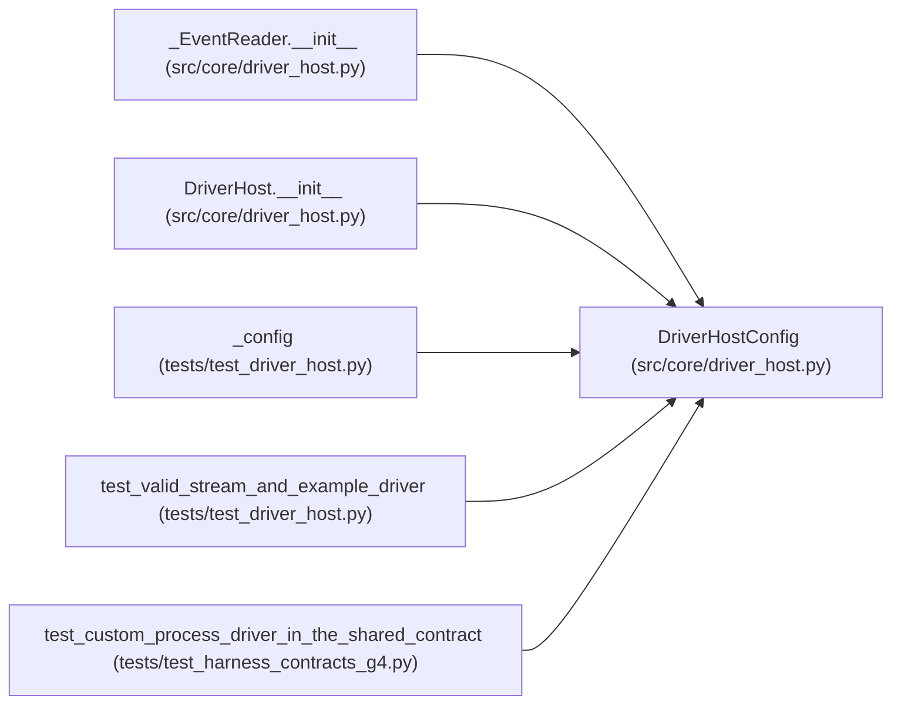

# DriverHostConfig

**Location:** `src/core/driver_host.py:54`
**Kind:** Class
**Bases:** —
**Module:** [driver_host](../modules/driver_host.md)

**Decorators:** `@dataclass`

## Description

How one driver process is launched and bounded.

## Attributes

| Name | Type | Default | Description |
|------|------|---------|-------------|
| `executable` | `tuple[str, ...]` | *required* | — |
| `run_id` | `str` | *required* | — |
| `workspace` | `str` | *required* | — |
| `identity` | `Mapping[str, Any]` | *required* | — |
| `credential` | `str` | `''` | — |
| `env` | `Mapping[str, str]` | `field(default_factory=dict)` | — |
| `instruction_artifacts` | `Mapping[str, str]` | `field(default_factory=dict)` | — |
| `max_event_bytes` | `int` | `MAX_EVENT_BYTES_DEFAULT` | — |
| `max_buffered_events` | `int` | `MAX_BUFFERED_EVENTS_DEFAULT` | — |
| `max_protocol_errors` | `int` | `MAX_PROTOCOL_ERRORS_DEFAULT` | — |
| `start_deadline_s` | `float` | `START_DEADLINE_S_DEFAULT` | — |
| `cleanup_deadline_s` | `float` | `CLEANUP_DEADLINE_S_DEFAULT` | — |

## Methods

*No public methods. Inherits from base classes.*

## Relationships

<!-- Auto-generated relationship summary. Do not edit by hand. -->

### Summary

| Module | Methods | Attributes |
|---|---:|---|
| [driver_host](../modules/driver_host.md) | 0 | `cleanup_deadline_s`, `credential`, `env`, `executable`, `identity`, `instruction_artifacts`, `max_buffered_events`, `max_event_bytes`, `max_protocol_errors`, `run_id`, `start_deadline_s`, `workspace` |

### References

| Reference | Kind | Source | Call sites |
|---|---|---|---:|
| `_EventReader.__init__` | type_reference | [driver_host](../modules/driver_host.md) | — |
| `DriverHost.__init__` | type_reference | [driver_host](../modules/driver_host.md) | — |
| `_config` | call | [test_driver_host](../modules/test_driver_host.md) | 1 |
| `test_valid_stream_and_example_driver` | call | [test_driver_host](../modules/test_driver_host.md) | 1 |
| `test_custom_process_driver_in_the_shared_contract` | call | [test_harness_contracts_g4](../modules/test_harness_contracts_g4.md) | 1 |
