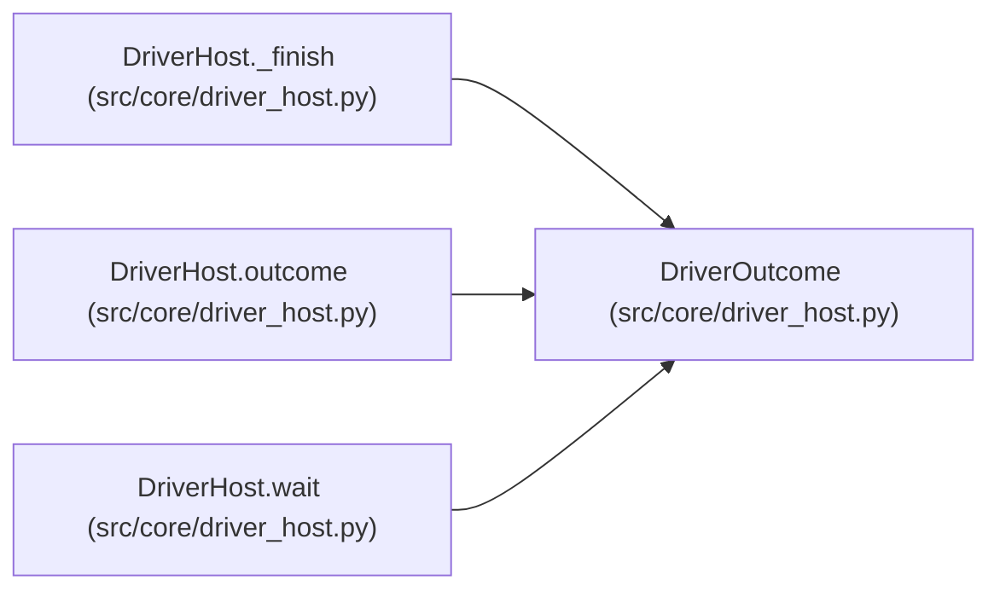

# DriverOutcome

**Location:** `src/core/driver_host.py:72`
**Kind:** Class
**Bases:** —
**Module:** [driver_host](../modules/driver_host.md)

**Decorators:** `@dataclass`

## Description

The attributed end state of one driver process.

## Attributes

| Name | Type | Default | Description |
|------|------|---------|-------------|
| `status` | `str` | *required* | — |
| `exit_code` | `Optional[int]` | *required* | — |
| `events_delivered` | `int` | *required* | — |
| `protocol_errors` | `int` | *required* | — |
| `oversized_events` | `int` | *required* | — |
| `cleanup_s` | `float` | *required* | — |
| `reason` | `str` | `''` | — |

## Methods

*No public methods. Inherits from base classes.*

## Relationships

<!-- Auto-generated relationship summary. Do not edit by hand. -->

### Summary

| Module | Methods | Attributes |
|---|---:|---|
| [driver_host](../modules/driver_host.md) | 0 | `cleanup_s`, `events_delivered`, `exit_code`, `oversized_events`, `protocol_errors`, `reason`, `status` |

### References

| Reference | Kind | Source | Call sites |
|---|---|---|---:|
| `DriverHost._finish` | call | [driver_host](../modules/driver_host.md) | 1 |
| `DriverHost._finish` | type_reference | [driver_host](../modules/driver_host.md) | — |
| `DriverHost.outcome` | type_reference | [driver_host](../modules/driver_host.md) | — |
| `DriverHost.wait` | type_reference | [driver_host](../modules/driver_host.md) | — |
