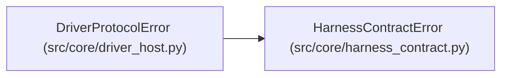

# DriverProtocolError

**Location:** `src/core/driver_host.py:84`
**Kind:** Class
**Bases:** `HarnessContractError`
**Module:** [driver_host](../modules/driver_host.md)

## Description

The driver's transport violated the documented protocol.

## Attributes

*No annotated attributes found.*

## Methods

*No public methods. Inherits from base classes.*

## Relationships

<!-- Auto-generated relationship summary. Do not edit by hand. -->

### Summary

| Module | Methods | Attributes |
|---|---:|---|
| [driver_host](../modules/driver_host.md) | 0 | — |

### Structure

| Kind | Entity | Module |
|---|---|---|
| Base | `HarnessContractError` | [harness_contract](../modules/harness_contract.md) |
