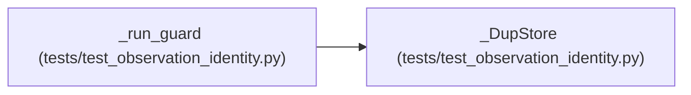

# _DupStore

**Location:** `tests/test_observation_identity.py:220`
**Kind:** Class
**Bases:** —
**Module:** [test_observation_identity](../modules/test_observation_identity.md)

## Description

_Auto-generated from `_DupStore` in `tests/test_observation_identity.py`._

## Attributes

*No annotated attributes found.*

## Methods

| Method | Signature | Decorators | Description |
|--------|-----------|------------|-------------|
| `__init__` | `(duplicate: Optional[Dict[str, Any]]) -> None` | — | — |
| `find_duplicate_trial_identity` | *(async)* `(**kwargs: Any)` | — | — |

## Relationships

<!-- Auto-generated relationship summary. Do not edit by hand. -->

### Summary

| Module | Methods | Attributes |
|---|---:|---|
| [test_observation_identity](../modules/test_observation_identity.md) | 2 | — |

### References

| Reference | Kind | Source | Call sites |
|---|---|---|---:|
| `_run_guard` | call | [test_observation_identity](../modules/test_observation_identity.md) | 1 |
