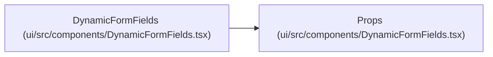

# Props

**Location:** `ui/src/components/DynamicFormFields.tsx:14`
**Kind:** Class
**Bases:** —
**Module:** [DynamicFormFields](../modules/DynamicFormFields.md)

## Description

_Auto-generated from `Props` in `ui/src/components/DynamicFormFields.tsx`._

## Attributes

| Name | Type | Required | Default | Description |
|------|------|----------|---------|-------------|
| `fields` | `FormField[]` | Yes | — | — |
| `values` | `Record<string, unknown>` | Yes | — | — |
| `onChange` | `(name: string, value: unknown) => void` | Yes | — | — |
| `skillId` | `string` | No | — | — |

## Methods

*No public methods. Inherits from base classes.*

## Relationships

<!-- Auto-generated relationship summary. Do not edit by hand. -->

### Summary

| Module | Methods | Attributes |
|---|---:|---|
| [DynamicFormFields](../modules/DynamicFormFields.md) | 0 | `fields`, `onChange`, `skillId`, `values` |

### References

| Reference | Kind | Source | Call sites |
|---|---|---|---:|
| `DynamicFormFields` | type_reference | [DynamicFormFields](../modules/DynamicFormFields.md) | — |
