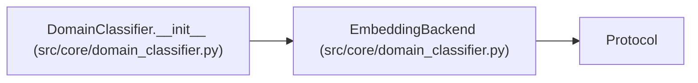

# EmbeddingBackend

**Location:** `src/core/domain_classifier.py:73`
**Kind:** Class
**Bases:** `Protocol`
**Module:** [domain_classifier](../modules/domain_classifier.md)

## Description

Pluggable text embedding (P5-016).

``LexicalEmbeddingBackend`` is the default; an ``LLMEmbeddingBackend``
(calling the configured provider's embeddings API) can drop in behind the
same ``DomainClassifier`` without touching callers. Not
``@runtime_checkable`` — typing-time contract only (house style).

## Attributes

*No annotated attributes found.*

## Methods

| Method | Signature | Decorators | Description |
|--------|-----------|------------|-------------|
| `embed` | `(text: str) -> Sequence[float]` | — | — |
| `dimensionality` | `() -> int` | `@property` | — |
| `content_hash` | `(text: str) -> str` | — | Stable hash of the embedding input (cache invalidation key). |

## Relationships

<!-- Auto-generated relationship summary. Do not edit by hand. -->

### Summary

| Module | Methods | Attributes |
|---|---:|---|
| [domain_classifier](../modules/domain_classifier.md) | 3 | — |

### Structure

| Kind | Entity | Module |
|---|---|---|
| Base | `Protocol` | — |

### References

| Reference | Kind | Source | Call sites |
|---|---|---|---:|
| `DomainClassifier.__init__` | type_reference | [domain_classifier](../modules/domain_classifier.md) | — |
