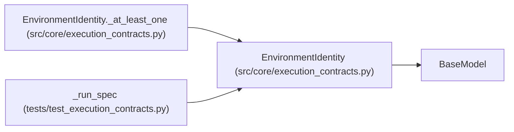

# EnvironmentIdentity

**Location:** `src/core/execution_contracts.py:786`
**Kind:** Pydantic model
**Bases:** `BaseModel`
**Module:** [execution_contracts](../modules/execution_contracts.md)

## Description

Pinned execution environment: image or dependency-lock digest.

## Model Configuration

| Setting | Value | Source |
|---------|-------|--------|
| `extra` | `'forbid'` | model_config |

## Validators

| Method | Scope | Fields | Mode | Options |
|--------|-------|--------|------|---------|
| `_at_least_one` | model | — | after | — |
| `_digest_shape` | field | image_digest, dependency_lock_digest | after | — |

## Attributes

| Name | Type | Wire name | Required | Nullable | Default | Constraints | Examples | Description |
|------|------|-----------|----------|----------|---------|-------------|-------------|----------|
| `image_digest` | `Optional[str]` | `image_digest` | No | Yes | `None` | — | — | — |
| `dependency_lock_digest` | `Optional[str]` | `dependency_lock_digest` | No | Yes | `None` | — | — | — |

## Methods

| Method | Signature | Decorators | Description |
|--------|-----------|------------|-------------|
| `_at_least_one` | `() -> 'EnvironmentIdentity'` | `@model_validator(mode='after')` | — |
| `_digest_shape` | `(value: Optional[str]) -> Optional[str]` | `@field_validator('image_digest', 'dependency_lock_digest')`, `@classmethod` | — |
| `digest` | `() -> str` | — | Single digest covering whichever identities were pinned. |

## Relationships

<!-- Auto-generated relationship summary. Do not edit by hand. -->

### Summary

| Module | Methods | Attributes |
|---|---:|---|
| [execution_contracts](../modules/execution_contracts.md) | 3 | `dependency_lock_digest`, `image_digest` |

### Structure

| Kind | Entity | Module |
|---|---|---|
| Base | `BaseModel` | — |

### References

| Reference | Kind | Source | Call sites |
|---|---|---|---:|
| `EnvironmentIdentity._at_least_one` | type_reference | [execution_contracts](../modules/execution_contracts.md) | — |
| `_run_spec` | call | [test_execution_contracts](../modules/test_execution_contracts.md) | 1 |
