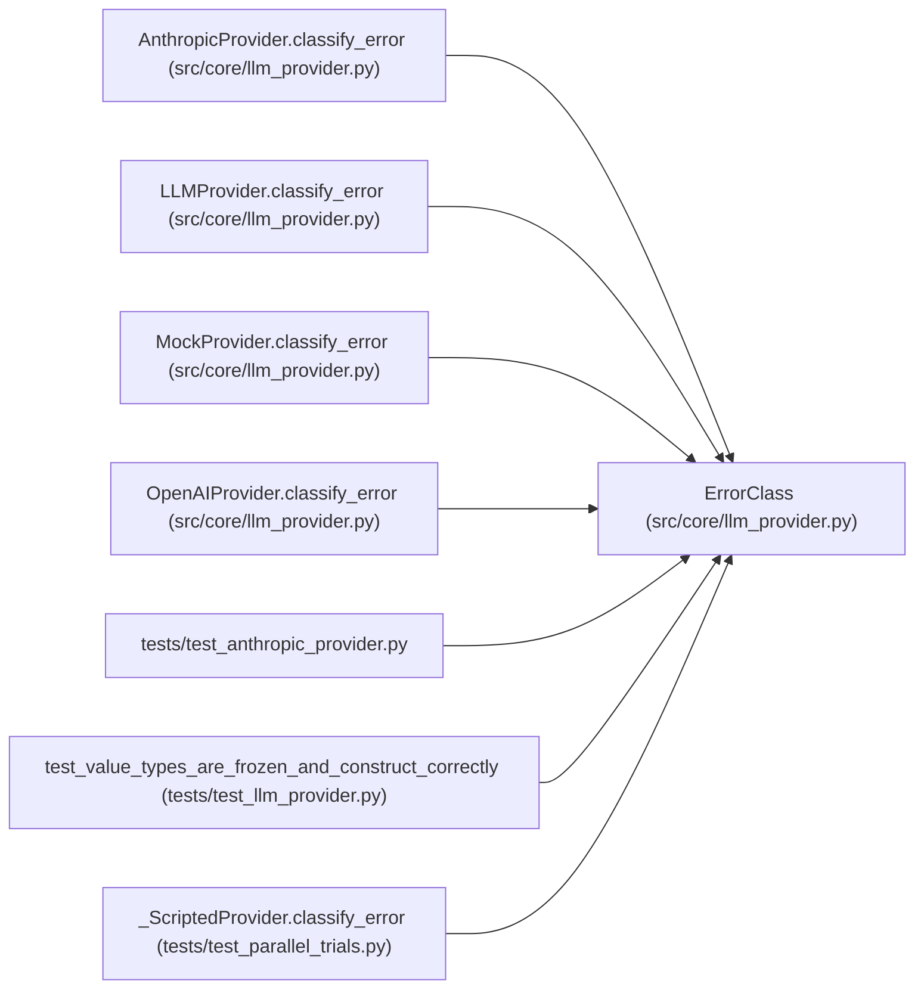

# ErrorClass

**Location:** `src/core/llm_provider.py:255`
**Kind:** Class
**Bases:** —
**Module:** [llm_provider](../modules/llm_provider.md)

**Decorators:** `@dataclass(frozen=True)`

## Description

Classification of a provider exception (→ loop-owned retry, R4 / D-retry).

``transient`` is the retry signal the loop reads (alongside its
budget-aware skip). ``retry_after_s`` carries a server-advised backoff when
available (e.g. ``Retry-After``).

## Attributes

| Name | Type | Default | Description |
|------|------|---------|-------------|
| `transient` | `bool` | *required* | — |
| `status_code` | `int \| None` | *required* | — |
| `retry_after_s` | `float \| None` | *required* | — |

## Methods

*No public methods. Inherits from base classes.*

## Relationships

<!-- Auto-generated relationship summary. Do not edit by hand. -->

### Summary

| Module | Methods | Attributes |
|---|---:|---|
| [llm_provider](../modules/llm_provider.md) | 0 | `retry_after_s`, `status_code`, `transient` |

### References

| Reference | Kind | Source | Call sites |
|---|---|---|---:|
| `AnthropicProvider.classify_error` | call | [llm_provider](../modules/llm_provider.md) | 3 |
| `AnthropicProvider.classify_error` | type_reference | [llm_provider](../modules/llm_provider.md) | — |
| `LLMProvider.classify_error` | type_reference | [llm_provider](../modules/llm_provider.md) | — |
| `MockProvider.classify_error` | call | [llm_provider](../modules/llm_provider.md) | 1 |
| `MockProvider.classify_error` | type_reference | [llm_provider](../modules/llm_provider.md) | — |
| `OpenAIProvider.classify_error` | call | [llm_provider](../modules/llm_provider.md) | 3 |
| `OpenAIProvider.classify_error` | type_reference | [llm_provider](../modules/llm_provider.md) | — |
| `test_anthropic_provider` | import | [test_anthropic_provider](../modules/test_anthropic_provider.md) | — |
| `test_value_types_are_frozen_and_construct_correctly` | type_reference | [test_llm_provider](../modules/test_llm_provider.md) | — |
| `_ScriptedProvider.classify_error` | call | [test_parallel_trials](../modules/test_parallel_trials.md) | 1 |
| `_ScriptedProvider.classify_error` | type_reference | [test_parallel_trials](../modules/test_parallel_trials.md) | — |
