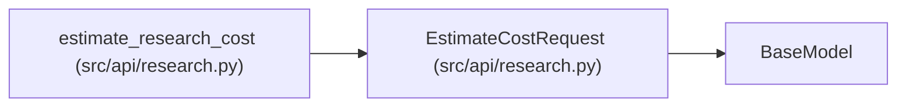

# EstimateCostRequest

**Location:** `src/api/research.py:588`
**Kind:** Pydantic model
**Bases:** `BaseModel`
**Module:** [research](../modules/research.md)

## Description

Body for ``POST /research/estimate-cost`` — the New-Research preview.

## Attributes

| Name | Type | Wire name | Required | Nullable | Default | Constraints | Examples | Description |
|------|------|-----------|----------|----------|---------|-------------|-------------|----------|
| `max_iterations` | `int` | `max_iterations` | No | No | `30` | ge=1; le=500 | — | — |
| `quick_mode` | `bool` | `quick_mode` | No | No | `False` | — | — | Quick mode uses a smaller session-average context proxy. |
| `max_budget_usd` | `Optional[float]` | `max_budget_usd` | No | Yes | `None` | ge=0.1; le=500.0 | — | When set, the response reports whether the estimate would be capped by this budget. |

## Methods

*No public methods. Inherits from base classes.*

## Relationships

<!-- Auto-generated relationship summary. Do not edit by hand. -->

### Summary

| Module | Methods | Attributes |
|---|---:|---|
| [research](../modules/research.md) | 0 | `max_budget_usd`, `max_iterations`, `quick_mode` |

### Structure

| Kind | Entity | Module |
|---|---|---|
| Base | `BaseModel` | — |

### References

| Reference | Kind | Source | Call sites |
|---|---|---|---:|
| `estimate_research_cost` | type_reference | [research](../modules/research.md) | — |
