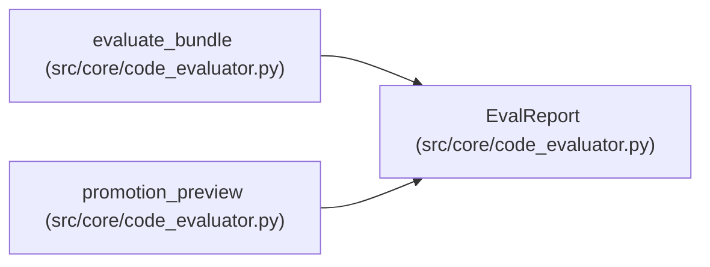

# EvalReport

**Location:** `src/core/code_evaluator.py:59`
**Kind:** Class
**Bases:** —
**Module:** [code_evaluator](../modules/code_evaluator.md)

**Decorators:** `@dataclass`

## Description

The trusted evaluator's report: real evidence, honest gaps.

## Attributes

| Name | Type | Default | Description |
|------|------|---------|-------------|
| `passed` | `bool` | *required* | — |
| `bundle_digest` | `str` | *required* | — |
| `exit_codes` | `dict[str, int]` | `field(default_factory=dict)` | — |
| `tests` | `dict[str, Any]` | `field(default_factory=dict)` | — |
| `lint_ok` | `bool` | `False` | — |
| `type_ok` | `bool` | `False` | — |
| `performance` | `Optional[dict[str, Any]]` | `None` | — |
| `protected_edits_reverted` | `tuple[str, ...]` | `()` | — |
| `failures` | `tuple[str, ...]` | `()` | — |

## Methods

| Method | Signature | Decorators | Description |
|--------|-----------|------------|-------------|
| `as_dict` | `() -> dict[str, Any]` | — | — |

## Relationships

<!-- Auto-generated relationship summary. Do not edit by hand. -->

### Summary

| Module | Methods | Attributes |
|---|---:|---|
| [code_evaluator](../modules/code_evaluator.md) | 1 | `bundle_digest`, `exit_codes`, `failures`, `lint_ok`, `passed`, `performance`, `protected_edits_reverted`, `tests`, `type_ok` |

### References

| Reference | Kind | Source | Call sites |
|---|---|---|---:|
| `evaluate_bundle` | call | [code_evaluator](../modules/code_evaluator.md) | 1 |
| `evaluate_bundle` | type_reference | [code_evaluator](../modules/code_evaluator.md) | — |
| `promotion_preview` | type_reference | [code_evaluator](../modules/code_evaluator.md) | — |
