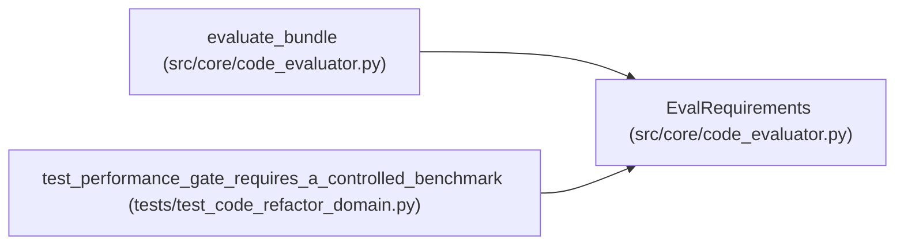

# EvalRequirements

**Location:** `src/core/code_evaluator.py:47`
**Kind:** Class
**Bases:** —
**Module:** [code_evaluator](../modules/code_evaluator.md)

**Decorators:** `@dataclass(frozen=True)`

## Description

Explicit gates: tests, lint, types, and optional performance.

## Attributes

| Name | Type | Default | Description |
|------|------|---------|-------------|
| `expected_tests` | `tuple[str, ...]` | *required* | — |
| `lint` | `bool` | `True` | — |
| `type_check` | `bool` | `True` | — |
| `performance_required` | `bool` | `False` | — |
| `performance_benchmark` | `Optional[str]` | `None` | — |
| `performance_budget_s` | `Optional[float]` | `None` | — |

## Methods

*No public methods. Inherits from base classes.*

## Relationships

<!-- Auto-generated relationship summary. Do not edit by hand. -->

### Summary

| Module | Methods | Attributes |
|---|---:|---|
| [code_evaluator](../modules/code_evaluator.md) | 0 | `expected_tests`, `lint`, `performance_benchmark`, `performance_budget_s`, `performance_required`, `type_check` |

### References

| Reference | Kind | Source | Call sites |
|---|---|---|---:|
| `evaluate_bundle` | type_reference | [code_evaluator](../modules/code_evaluator.md) | — |
| `test_performance_gate_requires_a_controlled_benchmark` | call | [test_code_refactor_domain](../modules/test_code_refactor_domain.md) | 2 |
