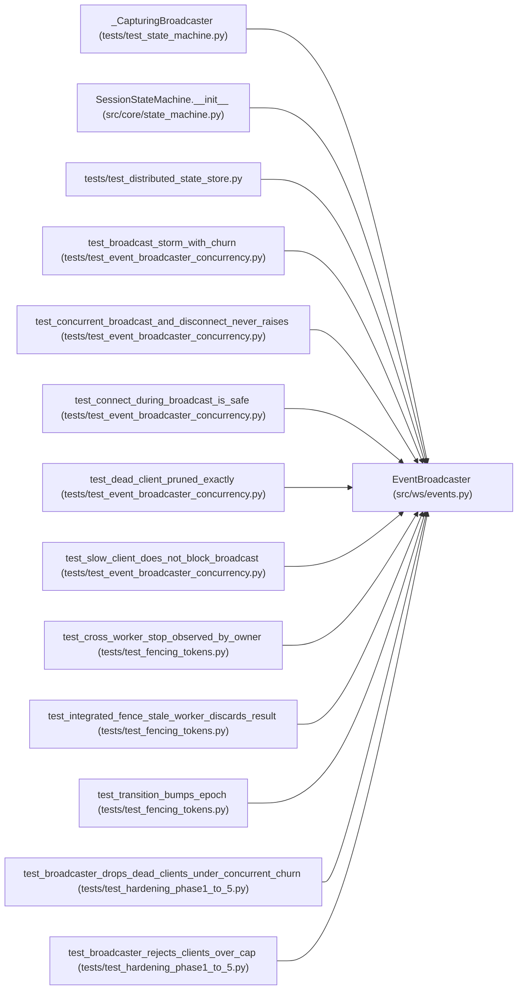

# EventBroadcaster

**Location:** `src/ws/events.py:68`
**Kind:** Class
**Bases:** —
**Module:** [events](../modules/events.md)

## Description

Manages WebSocket client connections and broadcasts events.

Phase 4.1: a single ``asyncio.Lock`` serializes mutations to the
client set so concurrent connect/disconnect/broadcast cannot leave
the set in an inconsistent state, and ``broadcast`` iterates a
snapshot so client churn during a fan-out cannot raise
``RuntimeError: Set changed size during iteration``.

## Attributes

*No annotated attributes found.*

## Methods

| Method | Signature | Decorators | Description |
|--------|-----------|------------|-------------|
| `__init__` | `() -> None` | — | — |
| `connect` | *(async)* `(websocket: WebSocket, *, subprotocol: str \| None = None, max_clients: int \| None = None) -> bool` | — | — |
| `disconnect` | *(async)* `(websocket: WebSocket) -> None` | — | — |
| `broadcast` | *(async)* `(event: Dict[str, Any]) -> None` | — | Send an event to all connected WebSocket clients. |
| `client_count` | `() -> int` | `@property` | — |

## Relationships

<!-- Auto-generated relationship summary. Do not edit by hand. -->

### Summary

| Module | Methods | Attributes |
|---|---:|---|
| [events](../modules/events.md) | 5 | — |

### Structure

| Kind | Entity | Module |
|---|---|---|
| Subclass | `_CapturingBroadcaster` | [test_state_machine](../modules/test_state_machine.md) |

### References

| Reference | Kind | Source | Call sites |
|---|---|---|---:|
| `SessionStateMachine.__init__` | type_reference | [state_machine](../modules/state_machine.md) | — |
| `test_distributed_state_store` | import | [test_distributed_state_store](../modules/test_distributed_state_store.md) | — |
| `test_broadcast_storm_with_churn` | call | [test_event_broadcaster_concurrency](../modules/test_event_broadcaster_concurrency.md) | 1 |
| `test_concurrent_broadcast_and_disconnect_never_raises` | call | [test_event_broadcaster_concurrency](../modules/test_event_broadcaster_concurrency.md) | 1 |
| `test_connect_during_broadcast_is_safe` | call | [test_event_broadcaster_concurrency](../modules/test_event_broadcaster_concurrency.md) | 1 |
| `test_dead_client_pruned_exactly` | call | [test_event_broadcaster_concurrency](../modules/test_event_broadcaster_concurrency.md) | 1 |
| `test_slow_client_does_not_block_broadcast` | call | [test_event_broadcaster_concurrency](../modules/test_event_broadcaster_concurrency.md) | 1 |
| `test_cross_worker_stop_observed_by_owner` | call | [test_fencing_tokens](../modules/test_fencing_tokens.md) | 1 |
| `test_integrated_fence_stale_worker_discards_result` | call | [test_fencing_tokens](../modules/test_fencing_tokens.md) | 1 |
| `test_transition_bumps_epoch` | call | [test_fencing_tokens](../modules/test_fencing_tokens.md) | 1 |
| `test_broadcaster_drops_dead_clients_under_concurrent_churn` | call | [test_hardening_phase1_to_5](../modules/test_hardening_phase1_to_5.md) | 1 |
| `test_broadcaster_rejects_clients_over_cap` | call | [test_hardening_phase1_to_5](../modules/test_hardening_phase1_to_5.md) | 1 |

> References: showing 12 of 13 logical references; 1 omitted by the 12-row generated summary limit.
