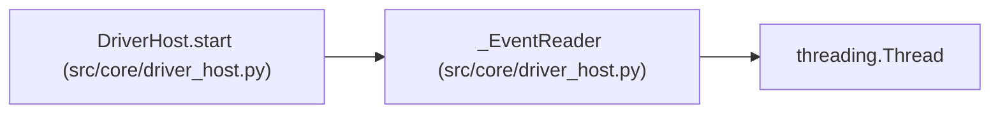

# _EventReader

**Location:** `src/core/driver_host.py:88`
**Kind:** Class
**Bases:** `threading.Thread`
**Module:** [driver_host](../modules/driver_host.md)

## Description

Bounded stdout reader: normalizes JSONL, enforces size and queue
bounds, and records protocol violations instead of trusting them.

## Attributes

*No annotated attributes found.*

## Methods

| Method | Signature | Decorators | Description |
|--------|-----------|------------|-------------|
| `__init__` | `(stream: Any, config: DriverHostConfig, on_event: Any) -> None` | — | — |
| `run` | `() -> None` | — | — |
| `_handle_line` | `(line: bytes) -> None` | — | — |

## Relationships

<!-- Auto-generated relationship summary. Do not edit by hand. -->

### Summary

| Module | Methods | Attributes |
|---|---:|---|
| [driver_host](../modules/driver_host.md) | 3 | — |

### Structure

| Kind | Entity | Module |
|---|---|---|
| Base | `threading.Thread` | — |

### References

| Reference | Kind | Source | Call sites |
|---|---|---|---:|
| `DriverHost.start` | call | [driver_host](../modules/driver_host.md) | 1 |
