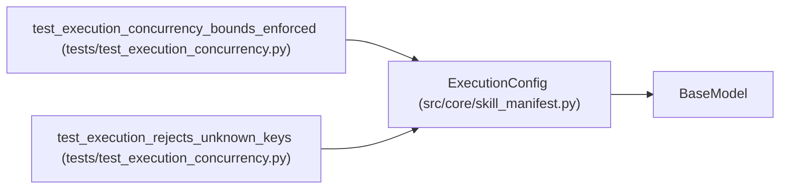

# ExecutionConfig

**Location:** `src/core/skill_manifest.py:937`
**Kind:** Pydantic model
**Bases:** `BaseModel`
**Module:** [skill_manifest](../modules/skill_manifest.md)

## Description

Per-skill execution capabilities (P1-4).

``concurrency`` declares how many independent trial commands the skill's
experiment loop may run in parallel (1..3). The default ``1`` preserves
today's strictly-sequential behavior; a skill opts in explicitly. Actual
parallel dispatch in the orchestrator loop is staged behind this field —
the sequential loop's per-command state (duplicate guard, runtime-command
records, snapshots, iteration recording) must be per-workdir before
concurrent execution is safe.

## Model Configuration

| Setting | Value | Source |
|---------|-------|--------|
| `extra` | `'forbid'` | model_config |

## Attributes

| Name | Type | Wire name | Required | Nullable | Default | Constraints | Examples | Description |
|------|------|-----------|----------|----------|---------|-------------|-------------|----------|
| `concurrency` | `int` | `concurrency` | No | No | `1` | ge=1; le=3 | — | — |

## Methods

*No public methods. Inherits from base classes.*

## Relationships

<!-- Auto-generated relationship summary. Do not edit by hand. -->

### Summary

| Module | Methods | Attributes |
|---|---:|---|
| [skill_manifest](../modules/skill_manifest.md) | 0 | `concurrency` |

### Structure

| Kind | Entity | Module |
|---|---|---|
| Base | `BaseModel` | — |

### References

| Reference | Kind | Source | Call sites |
|---|---|---|---:|
| `test_execution_concurrency_bounds_enforced` | call | [test_execution_concurrency](../modules/test_execution_concurrency.md) | 2 |
| `test_execution_rejects_unknown_keys` | call | [test_execution_concurrency](../modules/test_execution_concurrency.md) | 1 |
