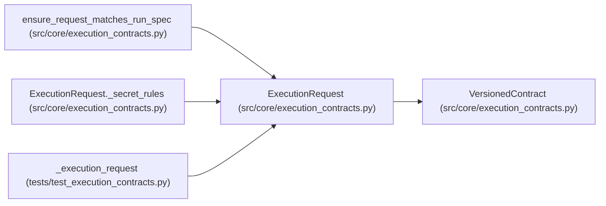

# ExecutionRequest

**Location:** `src/core/execution_contracts.py:703`
**Kind:** Pydantic model
**Bases:** `VersionedContract`
**Module:** [execution_contracts](../modules/execution_contracts.md)

## Description

One approved attempt: what the experiment executor may execute.

The executor resolves this request against the pinned run specification,
stages inputs, enforces the declared policy, executes, and collects
artifacts. A harness that runs its own shell still faces this contract;
it cannot bypass trusted evaluation.

## Model Configuration

| Setting | Value | Source |
|---------|-------|--------|
| `extra` | `'forbid'` | model_config |

## Validators

| Method | Scope | Fields | Mode | Options |
|--------|-------|--------|------|---------|
| `_digest_shape` | field | run_spec_digest, evaluator_digest, environment_digest | after | — |
| `_dataset_digests_shape` | field | dataset_digests | after | — |
| `_secret_rules` | model | — | after | — |

## Attributes

| Name | Type | Wire name | Required | Nullable | Default | Constraints | Examples | Description |
|------|------|-----------|----------|----------|---------|-------------|-------------|----------|
| `schema_version` | `str` | `schema_version` | No | No | `EXECUTION_REQUEST_SCHEMA_VERSION` | — | — | — |
| `request_id` | `str` | `request_id` | Yes | No | — | min_length=1 | — | — |
| `run_id` | `str` | `run_id` | Yes | No | — | min_length=1 | — | — |
| `attempt_id` | `str` | `attempt_id` | Yes | No | — | min_length=1 | — | — |
| `integration` | `IntegrationDirection` | `integration` | Yes | No | — | — | — | — |
| `run_spec_digest` | `str` | `run_spec_digest` | Yes | No | — | — | — | — |
| `candidate` | `CandidateIdentity` | `candidate` | Yes | No | — | — | — | — |
| `evaluator_digest` | `str` | `evaluator_digest` | Yes | No | — | — | — | — |
| `dataset_digests` | `list[str]` | `dataset_digests` | Yes | No | — | min_length=1 | — | — |
| `environment_digest` | `str` | `environment_digest` | Yes | No | — | — | — | — |
| `workspace` | `WorkspaceBounds` | `workspace` | Yes | No | — | — | — | — |
| `network` | `NetworkPolicy` | `network` | Yes | No | — | — | — | — |
| `resources` | `ResourceLimits` | `resources` | Yes | No | — | — | — | — |
| `secrets` | `list[SecretReference]` | `secrets` | No | No | factory: `list` | — | — | — |

## Methods

| Method | Signature | Decorators | Description |
|--------|-----------|------------|-------------|
| `_digest_shape` | `(value: str) -> str` | `@field_validator('run_spec_digest', 'evaluator_digest', 'environment_digest')`, `@classmethod` | — |
| `_dataset_digests_shape` | `(value: list[str]) -> list[str]` | `@field_validator('dataset_digests')`, `@classmethod` | — |
| `_secret_rules` | `() -> 'ExecutionRequest'` | `@model_validator(mode='after')` | — |

## Relationships

<!-- Auto-generated relationship summary. Do not edit by hand. -->

### Summary

| Module | Methods | Attributes |
|---|---:|---|
| [execution_contracts](../modules/execution_contracts.md) | 3 | `attempt_id`, `candidate`, `dataset_digests`, `environment_digest`, `evaluator_digest`, `integration`, `network`, `request_id`, `resources`, `run_id`, `run_spec_digest`, `schema_version` |

### Structure

| Kind | Entity | Module |
|---|---|---|
| Base | `VersionedContract` | [execution_contracts](../modules/execution_contracts.md) |

### References

| Reference | Kind | Source | Call sites |
|---|---|---|---:|
| `ensure_request_matches_run_spec` | type_reference | [execution_contracts](../modules/execution_contracts.md) | — |
| `ExecutionRequest._secret_rules` | type_reference | [execution_contracts](../modules/execution_contracts.md) | — |
| `_execution_request` | call | [test_execution_contracts](../modules/test_execution_contracts.md) | 1 |
