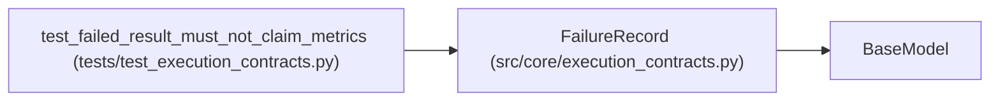

# FailureRecord

**Location:** `src/core/execution_contracts.py:571`
**Kind:** Pydantic model
**Bases:** `BaseModel`
**Module:** [execution_contracts](../modules/execution_contracts.md)

## Description

Structured failure detail for an attempt that produced no metrics.

## Model Configuration

| Setting | Value | Source |
|---------|-------|--------|
| `extra` | `'forbid'` | model_config |

## Attributes

| Name | Type | Wire name | Required | Nullable | Default | Constraints | Examples | Description |
|------|------|-----------|----------|----------|---------|-------------|-------------|----------|
| `code` | `str` | `code` | Yes | No | — | min_length=1 | — | — |
| `message` | `str` | `message` | Yes | No | — | — | — | — |
| `stage` | `Literal['staging', 'execution', 'evaluation', 'ingestion']` | `stage` | Yes | No | — | — | — | — |
| `retryable` | `bool` | `retryable` | No | No | `False` | — | — | — |

## Methods

*No public methods. Inherits from base classes.*

## Relationships

<!-- Auto-generated relationship summary. Do not edit by hand. -->

### Summary

| Module | Methods | Attributes |
|---|---:|---|
| [execution_contracts](../modules/execution_contracts.md) | 0 | `code`, `message`, `retryable`, `stage` |

### Structure

| Kind | Entity | Module |
|---|---|---|
| Base | `BaseModel` | — |

### References

| Reference | Kind | Source | Call sites |
|---|---|---|---:|
| `test_failed_result_must_not_claim_metrics` | call | [test_execution_contracts](../modules/test_execution_contracts.md) | 1 |
