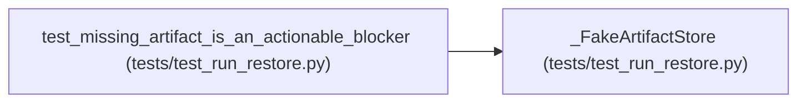

# _FakeArtifactStore

**Location:** `tests/test_run_restore.py:105`
**Kind:** Class
**Bases:** —
**Module:** [test_run_restore](../modules/test_run_restore.md)

## Description

_Auto-generated from `_FakeArtifactStore` in `tests/test_run_restore.py`._

## Attributes

*No annotated attributes found.*

## Methods

| Method | Signature | Decorators | Description |
|--------|-----------|------------|-------------|
| `__init__` | `(present)` | — | — |
| `verify_bundle` | `(digest: str) -> bool` | — | — |

## Relationships

<!-- Auto-generated relationship summary. Do not edit by hand. -->

### Summary

| Module | Methods | Attributes |
|---|---:|---|
| [test_run_restore](../modules/test_run_restore.md) | 2 | — |

### References

| Reference | Kind | Source | Call sites |
|---|---|---|---:|
| `test_missing_artifact_is_an_actionable_blocker` | call | [test_run_restore](../modules/test_run_restore.md) | 1 |
