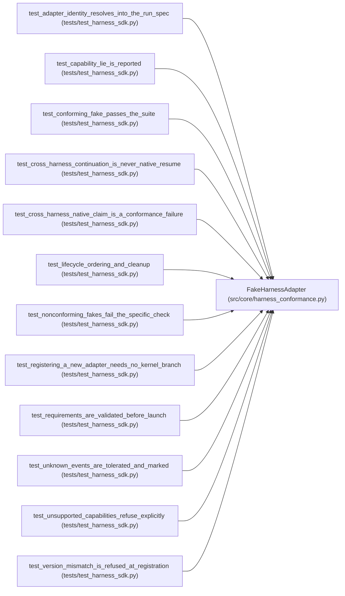

# FakeHarnessAdapter

**Location:** `src/core/harness_conformance.py:34`
**Kind:** Class
**Bases:** —
**Module:** [harness_conformance](../modules/harness_conformance.md)

## Description

A deterministic harness adapter for specification and testing.

``violations`` names the conformance rules the adapter deliberately
breaks (see ``run_conformance``); with none it is fully conforming.

## Attributes

*No annotated attributes found.*

## Methods

| Method | Signature | Decorators | Description |
|--------|-----------|------------|-------------|
| `__init__` | `(*, name: str = 'fake-harness', version: str = '1.0.0', contract_version: str = HARNESS_CONTRACT_VERSION, capabilities: frozenset[str] = frozenset(), permissions: Optional[Mapping[str, Any]] = None, events: tuple[Mapping[str, Any], ...] = (), violations: frozenset[str] = frozenset()) -> None` | — | — |
| `identity` | `() -> Mapping[str, Any]` | — | — |
| `capabilities` | `() -> frozenset[str]` | — | — |
| `pause` | `(handle: str) -> None` | — | — |
| `resume` | `(handle: str) -> None` | — | — |
| `steering` | `(handle: str, proposal: Mapping[str, Any]) -> None` | — | — |
| `start` | `(request: Mapping[str, Any]) -> Mapping[str, Any]` | — | — |
| `attach` | `(request: Mapping[str, Any]) -> Mapping[str, Any]` | — | — |
| `events` | `(handle: str) -> Iterator[Mapping[str, Any]]` | — | — |
| `cancel` | `(handle: str) -> None` | — | — |
| `close` | `(handle: str) -> None` | — | — |
| `_new_handle` | `(request: Mapping[str, Any]) -> str` | — | — |
| `_require_open` | `(handle: str, op: str) -> None` | — | — |

## Relationships

<!-- Auto-generated relationship summary. Do not edit by hand. -->

### Summary

| Module | Methods | Attributes |
|---|---:|---|
| [harness_conformance](../modules/harness_conformance.md) | 13 | — |

### References

| Reference | Kind | Source | Call sites |
|---|---|---|---:|
| `test_adapter_identity_resolves_into_the_run_spec` | call | [test_harness_sdk](../modules/test_harness_sdk.md) | 1 |
| `test_capability_lie_is_reported` | call | [test_harness_sdk](../modules/test_harness_sdk.md) | 1 |
| `test_conforming_fake_passes_the_suite` | call | [test_harness_sdk](../modules/test_harness_sdk.md) | 2 |
| `test_cross_harness_continuation_is_never_native_resume` | call | [test_harness_sdk](../modules/test_harness_sdk.md) | 1 |
| `test_cross_harness_native_claim_is_a_conformance_failure` | call | [test_harness_sdk](../modules/test_harness_sdk.md) | 1 |
| `test_lifecycle_ordering_and_cleanup` | call | [test_harness_sdk](../modules/test_harness_sdk.md) | 1 |
| `test_nonconforming_fakes_fail_the_specific_check` | call | [test_harness_sdk](../modules/test_harness_sdk.md) | 1 |
| `test_registering_a_new_adapter_needs_no_kernel_branch` | call | [test_harness_sdk](../modules/test_harness_sdk.md) | 1 |
| `test_requirements_are_validated_before_launch` | call | [test_harness_sdk](../modules/test_harness_sdk.md) | 1 |
| `test_unknown_events_are_tolerated_and_marked` | call | [test_harness_sdk](../modules/test_harness_sdk.md) | 1 |
| `test_unsupported_capabilities_refuse_explicitly` | call | [test_harness_sdk](../modules/test_harness_sdk.md) | 1 |
| `test_version_mismatch_is_refused_at_registration` | call | [test_harness_sdk](../modules/test_harness_sdk.md) | 1 |
