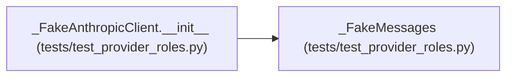

# _FakeMessages

**Location:** `tests/test_provider_roles.py:89`
**Kind:** Class
**Bases:** —
**Module:** [test_provider_roles](../modules/test_provider_roles.md)

## Description

_Auto-generated from `_FakeMessages` in `tests/test_provider_roles.py`._

## Attributes

*No annotated attributes found.*

## Methods

| Method | Signature | Decorators | Description |
|--------|-----------|------------|-------------|
| `__init__` | `() -> None` | — | — |
| `create` | *(async)* `(**kwargs)` | — | — |

## Relationships

<!-- Auto-generated relationship summary. Do not edit by hand. -->

### Summary

| Module | Methods | Attributes |
|---|---:|---|
| [test_provider_roles](../modules/test_provider_roles.md) | 2 | — |

### References

| Reference | Kind | Source | Call sites |
|---|---|---|---:|
| `_FakeAnthropicClient.__init__` | call | [test_provider_roles](../modules/test_provider_roles.md) | 1 |
