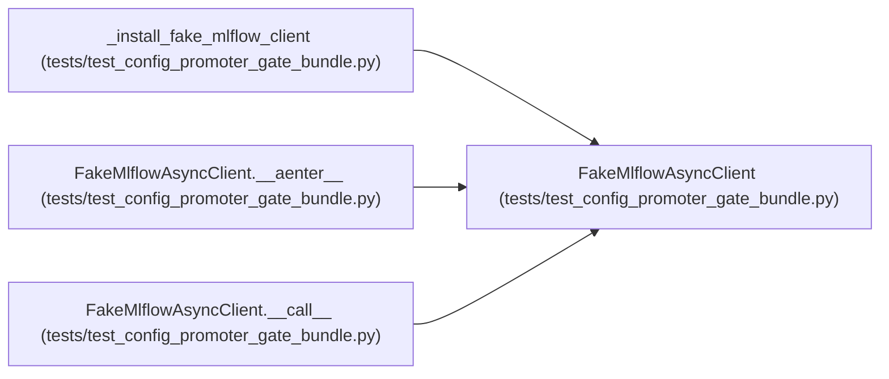

# FakeMlflowAsyncClient

**Location:** `tests/test_config_promoter_gate_bundle.py:697`
**Kind:** Class
**Bases:** —
**Module:** [test_config_promoter_gate_bundle](../modules/test_config_promoter_gate_bundle.md)

## Description

_Auto-generated from `FakeMlflowAsyncClient` in `tests/test_config_promoter_gate_bundle.py`._

## Attributes

*No annotated attributes found.*

## Methods

| Method | Signature | Decorators | Description |
|--------|-----------|------------|-------------|
| `__init__` | `(*, composites: list[dict], promote_payload: dict \| None = None, promote_status_code: int = 200) -> None` | — | — |
| `__call__` | `(*args, **kwargs) -> 'FakeMlflowAsyncClient'` | — | — |
| `__aenter__` | *(async)* `() -> 'FakeMlflowAsyncClient'` | — | — |
| `__aexit__` | *(async)* `(exc_type, exc, tb) -> None` | — | — |
| `get` | *(async)* `(url: str, *, headers: dict \| None = None, params: dict \| None = None)` | — | — |
| `post` | *(async)* `(url: str, *, headers: dict \| None = None, json: dict \| None = None)` | — | — |

## Relationships

<!-- Auto-generated relationship summary. Do not edit by hand. -->

### Summary

| Module | Methods | Attributes |
|---|---:|---|
| [test_config_promoter_gate_bundle](../modules/test_config_promoter_gate_bundle.md) | 6 | — |

### References

| Reference | Kind | Source | Call sites |
|---|---|---|---:|
| `_install_fake_mlflow_client` | call | [test_config_promoter_gate_bundle](../modules/test_config_promoter_gate_bundle.md) | 1 |
| `_install_fake_mlflow_client` | type_reference | [test_config_promoter_gate_bundle](../modules/test_config_promoter_gate_bundle.md) | — |
| `FakeMlflowAsyncClient.__aenter__` | type_reference | [test_config_promoter_gate_bundle](../modules/test_config_promoter_gate_bundle.md) | — |
| `FakeMlflowAsyncClient.__call__` | type_reference | [test_config_promoter_gate_bundle](../modules/test_config_promoter_gate_bundle.md) | — |
