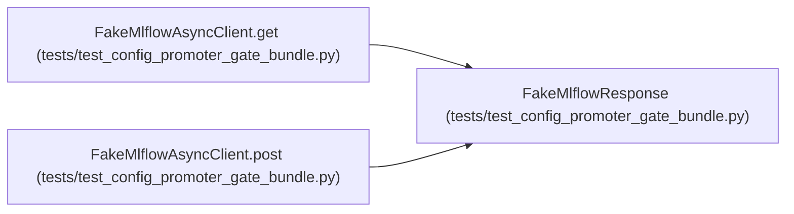

# FakeMlflowResponse

**Location:** `tests/test_config_promoter_gate_bundle.py:687`
**Kind:** Class
**Bases:** —
**Module:** [test_config_promoter_gate_bundle](../modules/test_config_promoter_gate_bundle.md)

## Description

_Auto-generated from `FakeMlflowResponse` in `tests/test_config_promoter_gate_bundle.py`._

## Attributes

*No annotated attributes found.*

## Methods

| Method | Signature | Decorators | Description |
|--------|-----------|------------|-------------|
| `__init__` | `(status_code: int, payload: object) -> None` | — | — |
| `json` | `() -> object` | — | — |

## Relationships

<!-- Auto-generated relationship summary. Do not edit by hand. -->

### Summary

| Module | Methods | Attributes |
|---|---:|---|
| [test_config_promoter_gate_bundle](../modules/test_config_promoter_gate_bundle.md) | 2 | — |

### References

| Reference | Kind | Source | Call sites |
|---|---|---|---:|
| `FakeMlflowAsyncClient.get` | call | [test_config_promoter_gate_bundle](../modules/test_config_promoter_gate_bundle.md) | 1 |
| `FakeMlflowAsyncClient.post` | call | [test_config_promoter_gate_bundle](../modules/test_config_promoter_gate_bundle.md) | 1 |
