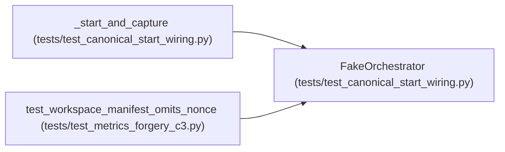

# FakeOrchestrator

**Location:** `tests/test_canonical_start_wiring.py:56`
**Kind:** Class
**Bases:** —
**Module:** [test_canonical_start_wiring](../modules/test_canonical_start_wiring.md)

## Description

Captures the ResearchConfig the session manager hands to run().

## Attributes

*No annotated attributes found.*

## Methods

| Method | Signature | Decorators | Description |
|--------|-----------|------------|-------------|
| `__init__` | `(store: Any) -> None` | — | — |
| `run` | *(async)* `(config: ResearchConfig) -> None` | — | — |
| `request_stop` | `(research_id: str) -> None` | — | — |
| `request_pause` | `(research_id: str) -> None` | — | — |
| `request_resume` | `(research_id: str) -> None` | — | — |

## Relationships

<!-- Auto-generated relationship summary. Do not edit by hand. -->

### Summary

| Module | Methods | Attributes |
|---|---:|---|
| [test_canonical_start_wiring](../modules/test_canonical_start_wiring.md) | 5 | — |

### References

| Reference | Kind | Source | Call sites |
|---|---|---|---:|
| `_start_and_capture` | call | [test_canonical_start_wiring](../modules/test_canonical_start_wiring.md) | 1 |
| `_start_and_capture` | type_reference | [test_canonical_start_wiring](../modules/test_canonical_start_wiring.md) | — |
| `test_workspace_manifest_omits_nonce` | call | [test_metrics_forgery_c3](../modules/test_metrics_forgery_c3.md) | 1 |
