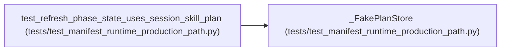

# _FakePlanStore

**Location:** `tests/test_manifest_runtime_production_path.py:174`
**Kind:** Class
**Bases:** —
**Module:** [test_manifest_runtime_production_path](../modules/test_manifest_runtime_production_path.md)

## Description

Minimal store surface for ``_refresh_phase_state``.

## Attributes

*No annotated attributes found.*

## Methods

| Method | Signature | Decorators | Description |
|--------|-----------|------------|-------------|
| `__init__` | `(iterations: List[Dict[str, Any]]) -> None` | — | — |
| `get_session` | *(async)* `(research_id: str)` | — | — |
| `get_iterations` | *(async)* `(research_id: str)` | — | — |
| `get_hpo_studies` | *(async)* `(research_id)` | — | — |
| `list_promotions` | *(async)* `()` | — | — |
| `update_session` | *(async)* `(research_id, **fields)` | — | — |

## Relationships

<!-- Auto-generated relationship summary. Do not edit by hand. -->

### Summary

| Module | Methods | Attributes |
|---|---:|---|
| [test_manifest_runtime_production_path](../modules/test_manifest_runtime_production_path.md) | 6 | — |

### References

| Reference | Kind | Source | Call sites |
|---|---|---|---:|
| `test_refresh_phase_state_uses_session_skill_plan` | call | [test_manifest_runtime_production_path](../modules/test_manifest_runtime_production_path.md) | 1 |
