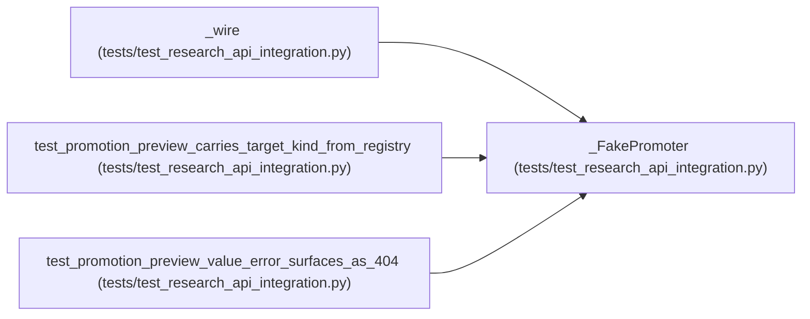

# _FakePromoter

**Location:** `tests/test_research_api_integration.py:108`
**Kind:** Class
**Bases:** —
**Module:** [test_research_api_integration](../modules/test_research_api_integration.md)

## Description

Returns a canned preview dict; ``target_kind`` is injected downstream.

## Attributes

*No annotated attributes found.*

## Methods

| Method | Signature | Decorators | Description |
|--------|-----------|------------|-------------|
| `preview` | *(async)* `(research_id, *, scope = 'development', approval = None)` | — | — |

## Relationships

<!-- Auto-generated relationship summary. Do not edit by hand. -->

### Summary

| Module | Methods | Attributes |
|---|---:|---|
| [test_research_api_integration](../modules/test_research_api_integration.md) | 1 | — |

### References

| Reference | Kind | Source | Call sites |
|---|---|---|---:|
| `_wire` | call | [test_research_api_integration](../modules/test_research_api_integration.md) | 1 |
| `test_promotion_preview_carries_target_kind_from_registry` | call | [test_research_api_integration](../modules/test_research_api_integration.md) | 1 |
| `test_promotion_preview_value_error_surfaces_as_404` | call | [test_research_api_integration](../modules/test_research_api_integration.md) | 1 |
