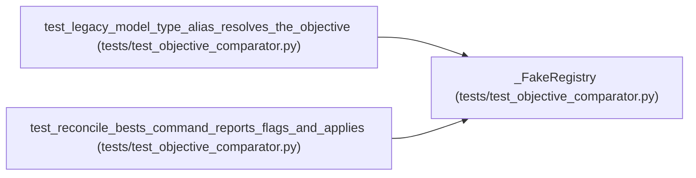

# _FakeRegistry

**Location:** `tests/test_objective_comparator.py:53`
**Kind:** Class
**Bases:** —
**Module:** [test_objective_comparator](../modules/test_objective_comparator.md)

## Description

_Auto-generated from `_FakeRegistry` in `tests/test_objective_comparator.py`._

## Attributes

*No annotated attributes found.*

## Methods

| Method | Signature | Decorators | Description |
|--------|-----------|------------|-------------|
| `__init__` | `(skills: Dict[str, SimpleNamespace]) -> None` | — | — |
| `get` | `(skill_id: str) -> SimpleNamespace` | — | — |

## Relationships

<!-- Auto-generated relationship summary. Do not edit by hand. -->

### Summary

| Module | Methods | Attributes |
|---|---:|---|
| [test_objective_comparator](../modules/test_objective_comparator.md) | 2 | — |

### References

| Reference | Kind | Source | Call sites |
|---|---|---|---:|
| `test_legacy_model_type_alias_resolves_the_objective` | call | [test_objective_comparator](../modules/test_objective_comparator.md) | 1 |
| `test_reconcile_bests_command_reports_flags_and_applies` | call | [test_objective_comparator](../modules/test_objective_comparator.md) | 1 |
