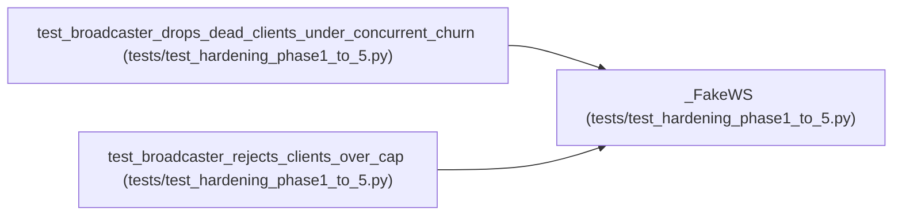

# _FakeWS

**Location:** `tests/test_hardening_phase1_to_5.py:125`
**Kind:** Class
**Bases:** —
**Module:** [test_hardening_phase1_to_5](../modules/test_hardening_phase1_to_5.md)

## Description

_Auto-generated from `_FakeWS` in `tests/test_hardening_phase1_to_5.py`._

## Attributes

*No annotated attributes found.*

## Methods

| Method | Signature | Decorators | Description |
|--------|-----------|------------|-------------|
| `__init__` | `(*, fail: bool = False) -> None` | — | — |
| `accept` | *(async)* `(*, subprotocol: str \| None = None) -> None` | — | — |
| `close` | *(async)* `(*, code: int = 1000) -> None` | — | — |
| `send_text` | *(async)* `(payload: str) -> None` | — | — |

## Relationships

<!-- Auto-generated relationship summary. Do not edit by hand. -->

### Summary

| Module | Methods | Attributes |
|---|---:|---|
| [test_hardening_phase1_to_5](../modules/test_hardening_phase1_to_5.md) | 4 | — |

### References

| Reference | Kind | Source | Call sites |
|---|---|---|---:|
| `test_broadcaster_drops_dead_clients_under_concurrent_churn` | call | [test_hardening_phase1_to_5](../modules/test_hardening_phase1_to_5.md) | 2 |
| `test_broadcaster_rejects_clients_over_cap` | call | [test_hardening_phase1_to_5](../modules/test_hardening_phase1_to_5.md) | 2 |
