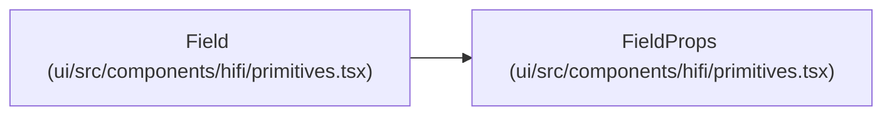

# FieldProps

**Location:** `ui/src/components/hifi/primitives.tsx:329`
**Kind:** Class
**Bases:** —
**Module:** [primitives](../modules/primitives.md)

## Description

_Auto-generated from `FieldProps` in `ui/src/components/hifi/primitives.tsx`._

## Attributes

| Name | Type | Required | Default | Description |
|------|------|----------|---------|-------------|
| `label` | `ReactNode` | Yes | — | — |
| `required` | `boolean` | No | — | — |
| `help` | `ReactNode` | No | — | — |
| `children` | `ReactNode` | Yes | — | — |

## Methods

*No public methods. Inherits from base classes.*

## Relationships

<!-- Auto-generated relationship summary. Do not edit by hand. -->

### Summary

| Module | Methods | Attributes |
|---|---:|---|
| [primitives](../modules/primitives.md) | 0 | `children`, `help`, `label`, `required` |

### References

| Reference | Kind | Source | Call sites |
|---|---|---|---:|
| `Field` | type_reference | [primitives](../modules/primitives.md) | — |
