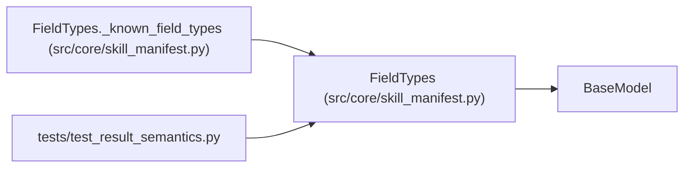

# FieldTypes

**Location:** `src/core/skill_manifest.py:629`
**Kind:** Pydantic model
**Bases:** `BaseModel`
**Module:** [skill_manifest](../modules/skill_manifest.md)

## Description

Type hints for parser fields used during coercion.

Names are a closed vocabulary (``string``, ``integer``, ``number``,
``boolean``, ``seconds``, ``milliseconds``, ``bytes``, ``ratio``); the
unit-bearing names are finite numbers whose unit is part of the
declaration and is preserved on the normalized result. Unknown names are
rejected at manifest load — a declaration without matching behavior must
never be silently accepted.

## Model Configuration

| Setting | Value | Source |
|---------|-------|--------|
| `extra` | `'allow'` | model_config |

## Validators

| Method | Scope | Fields | Mode | Options |
|--------|-------|--------|------|---------|
| `_known_field_types` | model | — | after | — |

## Attributes

*No annotated attributes found.*

## Methods

| Method | Signature | Decorators | Description |
|--------|-----------|------------|-------------|
| `_known_field_types` | `() -> 'FieldTypes'` | `@model_validator(mode='after')` | — |

## Relationships

<!-- Auto-generated relationship summary. Do not edit by hand. -->

### Summary

| Module | Methods | Attributes |
|---|---:|---|
| [skill_manifest](../modules/skill_manifest.md) | 1 | — |

### Structure

| Kind | Entity | Module |
|---|---|---|
| Base | `BaseModel` | — |

### References

| Reference | Kind | Source | Call sites |
|---|---|---|---:|
| `FieldTypes._known_field_types` | type_reference | [skill_manifest](../modules/skill_manifest.md) | — |
| `test_result_semantics` | import | [test_result_semantics](../modules/test_result_semantics.md) | — |
