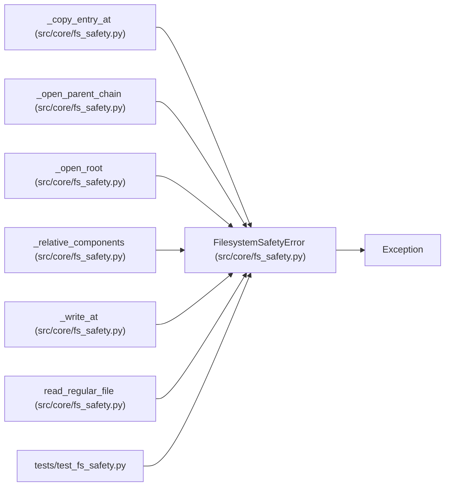

# FilesystemSafetyError

**Location:** `src/core/fs_safety.py:48`
**Kind:** Class
**Bases:** `Exception`
**Module:** [fs_safety](../modules/fs_safety.md)

## Description

A denied filesystem operation.

``operation`` names the denied operation (``write`` / ``read`` /
``copy`` / ``path``); the message repeats it alongside the path and the
reason so callers and logs identify exactly what was refused.

## Attributes

*No annotated attributes found.*

## Methods

| Method | Signature | Decorators | Description |
|--------|-----------|------------|-------------|
| `__init__` | `(operation: str, path: str, reason: str) -> None` | — | — |

## Relationships

<!-- Auto-generated relationship summary. Do not edit by hand. -->

### Summary

| Module | Methods | Attributes |
|---|---:|---|
| [fs_safety](../modules/fs_safety.md) | 1 | — |

### Structure

| Kind | Entity | Module |
|---|---|---|
| Base | `Exception` | — |

### References

| Reference | Kind | Source | Call sites |
|---|---|---|---:|
| `_copy_entry_at` | call | [fs_safety](../modules/fs_safety.md) | 3 |
| `_open_parent_chain` | call | [fs_safety](../modules/fs_safety.md) | 2 |
| `_open_root` | call | [fs_safety](../modules/fs_safety.md) | 1 |
| `_relative_components` | call | [fs_safety](../modules/fs_safety.md) | 2 |
| `_write_at` | call | [fs_safety](../modules/fs_safety.md) | 3 |
| `read_regular_file` | call | [fs_safety](../modules/fs_safety.md) | 3 |
| `test_fs_safety` | import | [test_fs_safety](../modules/test_fs_safety.md) | — |
