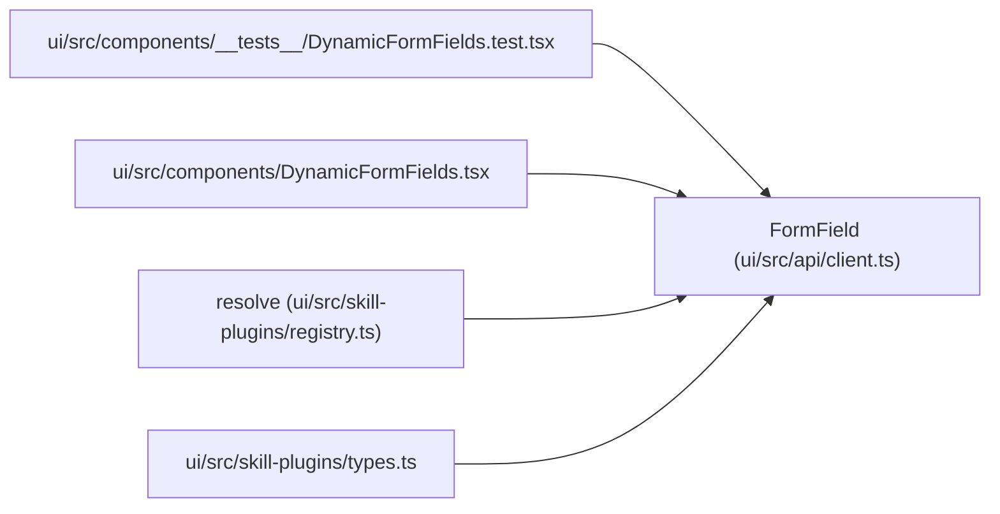

# FormField

**Location:** `ui/src/api/client.ts:501`
**Kind:** Class
**Bases:** —
**Module:** [client](../modules/client.md)

## Description

_Auto-generated from `FormField` in `ui/src/api/client.ts`._

## Attributes

| Name | Type | Required | Default | Description |
|------|------|----------|---------|-------------|
| `name` | `string` | Yes | — | — |
| `type` | `string` | Yes | — | — |
| `description` | `string` | No | — | — |
| `default` | `unknown` | No | — | — |
| `min` | `number` | No | — | — |
| `max` | `number` | No | — | — |
| `enum` | `string[]` | No | — | — |
| `options_url` | `string` | No | — | — |
| `visible_when` | `{ field: string; equals: string }` | No | — | — |
| `required` | `boolean` | No | — | — |

## Methods

*No public methods. Inherits from base classes.*

## Relationships

<!-- Auto-generated relationship summary. Do not edit by hand. -->

### Summary

| Module | Methods | Attributes |
|---|---:|---|
| [client](../modules/client.md) | 0 | `default`, `description`, `enum`, `max`, `min`, `name`, `options_url`, `required`, `type`, `visible_when` |

### References

| Reference | Kind | Source | Call sites |
|---|---|---|---:|
| `DynamicFormFields.test` | import | [DynamicFormFields.test](../modules/DynamicFormFields.test.md) | — |
| `DynamicFormFields` | import | [DynamicFormFields](../modules/DynamicFormFields.md) | — |
| `resolve` | type_reference | [registry](../modules/registry.md) | — |
| `types` | import | [types](../modules/types.md) | — |
