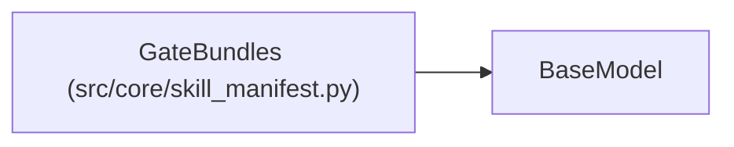

# GateBundles

**Location:** `src/core/skill_manifest.py:730`
**Kind:** Pydantic model
**Bases:** `BaseModel`
**Module:** [skill_manifest](../modules/skill_manifest.md)

## Description

Per-scope promotion gate bundles + override location (G4). Pure paths.

## Model Configuration

| Setting | Value | Source |
|---------|-------|--------|
| `extra` | `'forbid'` | model_config |

## Attributes

| Name | Type | Wire name | Required | Nullable | Default | Constraints | Examples | Description |
|------|------|-----------|----------|----------|---------|-------------|-------------|----------|
| `development` | `Optional[str]` | `development` | No | Yes | `None` | — | — | — |
| `production` | `Optional[str]` | `production` | No | Yes | `None` | — | — | — |
| `overrides_location` | `Optional[str]` | `overrides_location` | No | Yes | `None` | — | — | — |

## Methods

*No public methods. Inherits from base classes.*

## Relationships

<!-- Auto-generated relationship summary. Do not edit by hand. -->

### Summary

| Module | Methods | Attributes |
|---|---:|---|
| [skill_manifest](../modules/skill_manifest.md) | 0 | `development`, `overrides_location`, `production` |

### Structure

| Kind | Entity | Module |
|---|---|---|
| Base | `BaseModel` | — |
