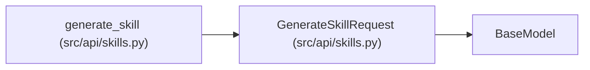

# GenerateSkillRequest

**Location:** `src/api/skills.py:443`
**Kind:** Pydantic model
**Bases:** `BaseModel`
**Module:** [src_api_skills](../modules/src_api_skills.md)

## Description

Body for ``POST /skills/generate``.

## Attributes

| Name | Type | Wire name | Required | Nullable | Default | Constraints | Examples | Description |
|------|------|-----------|----------|----------|---------|-------------|-------------|----------|
| `goal` | `str` | `goal` | Yes | No | — | min_length=8 | — | Natural-language description of the research domain. |
| `skill_id` | `Optional[str]` | `skill_id` | No | Yes | `None` | — | — | Override the generated kebab-case skill id. |
| `provider` | `Literal['anthropic', 'openai']` | `provider` | No | No | `'anthropic'` | — | — | — |
| `model` | `Optional[str]` | `model` | No | Yes | `None` | — | — | Model id (default: settings.anthropic_model). |

## Methods

*No public methods. Inherits from base classes.*

## Relationships

<!-- Auto-generated relationship summary. Do not edit by hand. -->

### Summary

| Module | Methods | Attributes |
|---|---:|---|
| [src_api_skills](../modules/src_api_skills.md) | 0 | `goal`, `model`, `provider`, `skill_id` |

### Structure

| Kind | Entity | Module |
|---|---|---|
| Base | `BaseModel` | — |

### References

| Reference | Kind | Source | Call sites |
|---|---|---|---:|
| `generate_skill` | type_reference | [src_api_skills](../modules/src_api_skills.md) | — |
