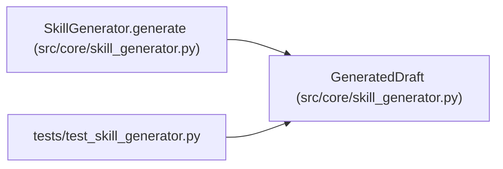

# GeneratedDraft

**Location:** `src/core/skill_generator.py:77`
**Kind:** Class
**Bases:** —
**Module:** [skill_generator](../modules/skill_generator.md)

**Decorators:** `@dataclass(frozen=True)`

## Description

A successfully drafted skill package (P5-023).

``skill_dir`` is the absolute path under ``skills/_drafts/<id>/``. The draft
is ``lifecycle_state="draft"`` — not selectable for production until
promoted (P5-024 / P5-026).

## Attributes

| Name | Type | Default | Description |
|------|------|---------|-------------|
| `skill_id` | `str` | *required* | — |
| `skill_dir` | `Path` | *required* | — |
| `manifest_yaml` | `str` | *required* | — |
| `bootstrap_py` | `str` | *required* | — |
| `eval_run_py` | `Optional[str]` | *required* | — |
| `skill_md` | `str` | *required* | — |
| `policy_findings` | `list[CommandPolicyFinding]` | `field(default_factory=list)` | — |
| `raw_llm_output` | `str` | `''` | — |

## Methods

*No public methods. Inherits from base classes.*

## Relationships

<!-- Auto-generated relationship summary. Do not edit by hand. -->

### Summary

| Module | Methods | Attributes |
|---|---:|---|
| [skill_generator](../modules/skill_generator.md) | 0 | `bootstrap_py`, `eval_run_py`, `manifest_yaml`, `policy_findings`, `raw_llm_output`, `skill_dir`, `skill_id`, `skill_md` |

### References

| Reference | Kind | Source | Call sites |
|---|---|---|---:|
| `SkillGenerator.generate` | call | [skill_generator](../modules/skill_generator.md) | 1 |
| `SkillGenerator.generate` | type_reference | [skill_generator](../modules/skill_generator.md) | — |
| `test_skill_generator` | import | [test_skill_generator](../modules/test_skill_generator.md) | — |
