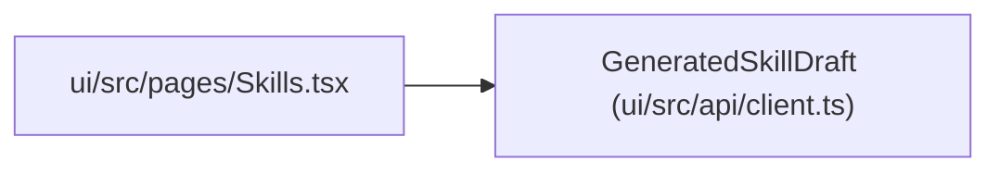

# GeneratedSkillDraft

**Location:** `ui/src/api/client.ts:481`
**Kind:** Class
**Bases:** —
**Module:** [client](../modules/client.md)

## Description

_Auto-generated from `GeneratedSkillDraft` in `ui/src/api/client.ts`._

## Attributes

| Name | Type | Required | Default | Description |
|------|------|----------|---------|-------------|
| `skill_id` | `string` | Yes | — | — |
| `draft_dir` | `string` | Yes | — | — |
| `files` | `string[]` | Yes | — | — |
| `lifecycle_state` | `'draft'` | Yes | — | — |
| `policy_findings` | `PolicyFinding[]` | Yes | — | — |
| `next` | `string` | Yes | — | — |

## Methods

*No public methods. Inherits from base classes.*

## Relationships

<!-- Auto-generated relationship summary. Do not edit by hand. -->

### Summary

| Module | Methods | Attributes |
|---|---:|---|
| [client](../modules/client.md) | 0 | `draft_dir`, `files`, `lifecycle_state`, `next`, `policy_findings`, `skill_id` |

### References

| Reference | Kind | Source | Call sites |
|---|---|---|---:|
| `Skills` | import | [ui_src_pages_Skills](../modules/ui_src_pages_Skills.md) | — |
