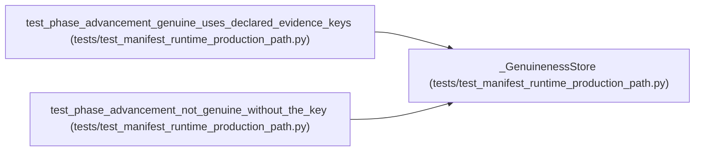

# _GenuinenessStore

**Location:** `tests/test_manifest_runtime_production_path.py:331`
**Kind:** Class
**Bases:** —
**Module:** [test_manifest_runtime_production_path](../modules/test_manifest_runtime_production_path.md)

## Description

_Auto-generated from `_GenuinenessStore` in `tests/test_manifest_runtime_production_path.py`._

## Attributes

*No annotated attributes found.*

## Methods

| Method | Signature | Decorators | Description |
|--------|-----------|------------|-------------|
| `__init__` | `(metrics: Dict[str, Any]) -> None` | — | — |
| `get_iterations` | *(async)* `(research_id: str)` | — | — |

## Relationships

<!-- Auto-generated relationship summary. Do not edit by hand. -->

### Summary

| Module | Methods | Attributes |
|---|---:|---|
| [test_manifest_runtime_production_path](../modules/test_manifest_runtime_production_path.md) | 2 | — |

### References

| Reference | Kind | Source | Call sites |
|---|---|---|---:|
| `test_phase_advancement_genuine_uses_declared_evidence_keys` | call | [test_manifest_runtime_production_path](../modules/test_manifest_runtime_production_path.md) | 1 |
| `test_phase_advancement_not_genuine_without_the_key` | call | [test_manifest_runtime_production_path](../modules/test_manifest_runtime_production_path.md) | 1 |
